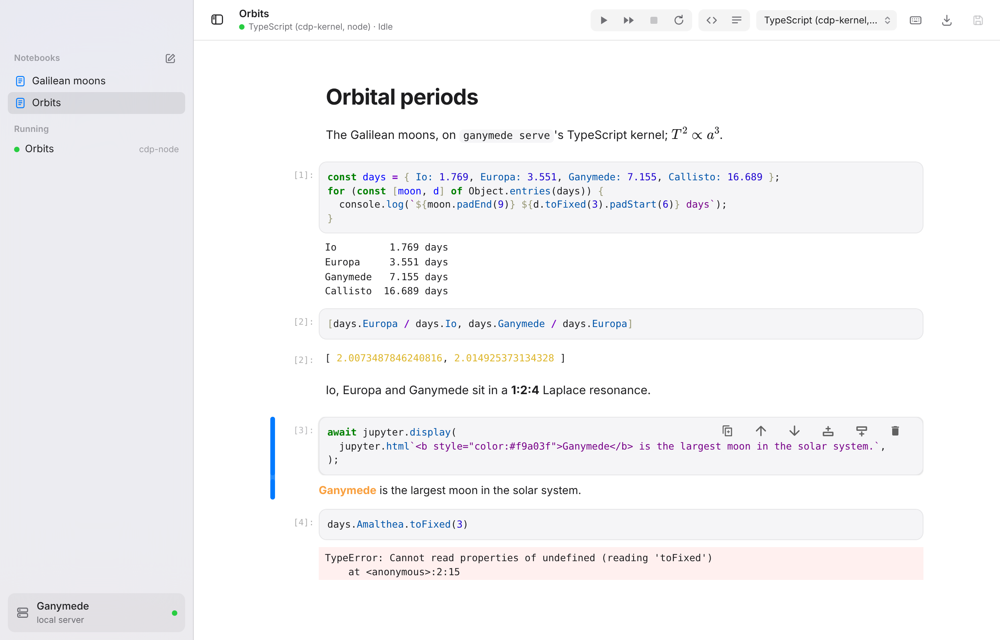
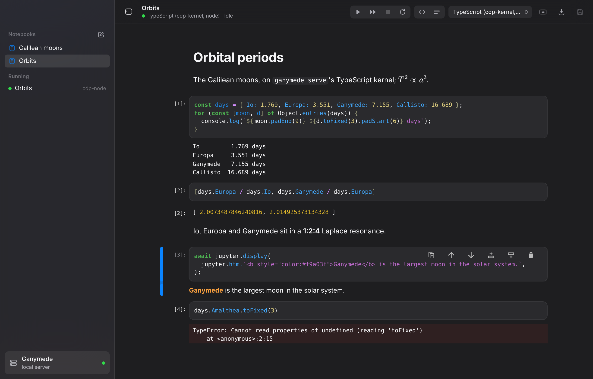
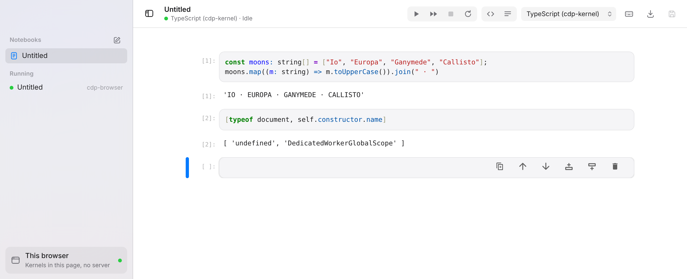

# ganymede-ui

A standalone notebook app for [Ganymede](https://github.com/tlockney/ganymede),
built on JupyterLab's notebook packages used directly as libraries, with Vite, styled to look like a macOS app, and
installable as a PWA. Kernels run either on a Ganymede server or in the
browser.

**Status:** working prototype. Runs notebooks against `ganymede serve` and
against in-browser kernels in a Web Worker: cdp-kernel's TypeScript kernel and
JupyterLite's JavaScript kernel. Started in
[tlockney/research](https://github.com/tlockney/research) and moved here with
its history.

[](https://github.com/tlockney/ganymede-ui/actions/workflows/ci.yml)

| Light                                                                                                                                                                                                                                          | Dark                                                                        |
| ---------------------------------------------------------------------------------------------------------------------------------------------------------------------------------------------------------------------------------------------- | --------------------------------------------------------------------------- |
|  |  |

_A notebook on `ganymede serve` running cdp-kernel's TypeScript kernel: stream, result, Markdown and math, HTML, and an error, saved._

<picture>
  <source media="(prefers-color-scheme: dark)" srcset="screenshots/browser-kernel-dark.png">
  
</picture>

_No server required: notebooks in the browser's storage, and the TypeScript kernel running in a Web Worker in the page._

## Where notebooks and kernels live


| Mode                      | Notebooks                         | Kernels                                                                                               |
| ------------------------- | --------------------------------- | ----------------------------------------------------------------------------------------------------- |
| Ganymede server           | Files in the folder it serves     | Any kernelspec installed on the server: TypeScript via cdp-kernel, Python via ipykernel, R, and so on |
| Ganymede, kernels in page | Files in the folder it serves     | The two in-browser kernels below                                                                      |
| This browser (no server)  | The browser's storage (IndexedDB) | cdp-kernel's TypeScript (the default) and JupyterLite's JavaScript, in a Web Worker                   |

There is no Python in the browser: no Pyodide, unlike JupyterLite. Python
runs only on a server, through an installed ipykernel. Compared with
JupyterLab, the app is the notebook alone (a file list, the running
kernels, no terminals, consoles or extensions); compared with JupyterLite,
it also runs against a real server.

## Run

You need Node.js 22.12 or later (CI uses 24). The server modes need
[Ganymede](https://ganymede-server.com/docs/install) 0.3.0 or later and a
kernel on it, such as cdp-kernel's TypeScript kernel, which Ganymede's
install script sets up.

```sh
ganymede serve --port 8888 --token test     # in a folder of notebooks
npm install
npm run dev                                 # http://localhost:5173/?token=test
```

The dev server proxies `/api` to `GANYMEDE_URL` (default
`http://127.0.0.1:8888`), so the page and the server share an origin. A token
in the page URL connects at once; otherwise a sheet asks where kernels run.
"This browser" needs no server at all. `npm run build && npm run preview`
(same proxy, port 4173) runs the production build, with offline use and
Workbox's service worker.

To use the app for real, have Ganymede serve the built app
(`ganymede serve --static-dir dist`, or a release), or host it anywhere
and connect it to a server with `--allow-origin`.
[docs/deploying.md](docs/deploying.md) has both setups step by step.

[`apple/`](apple/README.md) builds a Mac and an iPad/iPhone app that run
Ganymede in their own process and show this app in a web view.

## Using it

Open a notebook from the sidebar, which also lists running kernels. The
toolbar runs, interrupts and restarts the kernel, switches kernels, trusts
the notebook, downloads it, and saves (⌘S). Keyboard shortcuts follow
JupyterLab's; press `H` in command mode (or the keyboard button) for the
full list. Every shortcut can be rebound there, and changes stay in this
browser. [docs/shortcuts.md](docs/shortcuts.md) lists the defaults.

## Where your data lives

- **This browser:** notebooks are stored in the browser's IndexedDB for this
  origin, and kernels run in the page. Nothing is sent anywhere. Clearing
  the site's data deletes the notebooks.
- **Ganymede:** notebooks are files in the folder the server serves, and
  kernels run where the server runs them.
- **The connection:** the chosen backend, including the server URL and
  token, is saved in the browser's local storage
  (`ganymede-ui:backend`) and used on the next visit. Any script on the
  page's origin can read it, including the HTML and JavaScript output of a
  notebook you trust ([#55](https://github.com/tlockney/ganymede-ui/issues/55)
  tracks keeping it out). A `?token=` in the page URL is removed from the
  address bar once read. Served by Ganymede, the app connects on the login
  cookie and saves no token.
- **Trust:** Ganymede signs a notebook you trust, as Jupyter does, so its
  outputs render when reopened. The browser backend keeps no signatures, so
  trust lasts while the notebook is open.

Ganymede's [security page](https://ganymede-server.com/docs/security)
covers tokens, cookies and cross-origin access on the server side.

## Known gaps

It is a prototype. What it doesn't do yet, or does roughly:

- **Saving is manual.** There is no autosave and no warning when a tab
  with unsaved changes closes
  ([#56](https://github.com/tlockney/ganymede-ui/issues/56)). A save
  overwrites the file even if it changed on disk
  ([#57](https://github.com/tlockney/ganymede-ui/issues/57)), and a failed
  save, restart or kernel change shows no error
  ([#58](https://github.com/tlockney/ganymede-ui/issues/58)).
- **Trusted output runs in the app's page**, not a sandboxed frame
  ([#35](https://github.com/tlockney/ganymede-ui/issues/35)), and the token
  sits in local storage ([#55](https://github.com/tlockney/ganymede-ui/issues/55)).
- **Switching backends** leaves the old backend's kernels running with no
  way to reach them from the app
  ([#62](https://github.com/tlockney/ganymede-ui/issues/62)).
- **No file operations** beyond new notebook: no rename, delete or upload.
  No command palette or menus (the Mac app has a menu bar).
- **Widgets** need a running kernel; saved widget state isn't restored
  without one.
- **The Mac app** is a CI build, ad-hoc signed and not notarized; the iPad
  app is built from source with Xcode.

[Issues](https://github.com/tlockney/ganymede-ui/issues) has the full list.

## How it fits together

In short below; [docs/architecture.md](docs/architecture.md) has the full
picture, and the Ganymede site shows it at
[ganymede-server.com/docs/ganymede-ui/architecture](https://ganymede-server.com/docs/ganymede-ui/architecture).

- **Backends** (`src/lib/backends.ts`). The UI only uses a
  `ServiceManager.IManager`. `ganymede` builds one over REST and websocket;
  `browser` builds JupyterLite's in-page server (`src/lib/lite.ts`,
  `@jupyterlite/services`) with two Web Worker kernels, storing notebooks in
  IndexedDB: cdp-kernel's TypeScript kernel (`src/lib/cdp-kernel.ts`, from
  `@tlockney/cdp-kernel/browser`), the default, and JupyterLite's JavaScript
  kernel (`@jupyterlite/javascript-kernel`). A `ganymede` connection with
  `kernels: 'page'` (the sheet's "Run kernels in this page", or
  `?kernels=page` in the URL, which the iPad app uses) keeps notebooks on
  the server and runs these kernels in the page.
- **Notebook** (`src/components/NotebookPane.tsx`). JupyterLab's
  `Notebook` widget with a `SessionContext`, which starts or rejoins the
  file's kernel. The pane tracks status, and loads and saves nbformat
  through the contents API. `src/lib/jupyterlab.ts` builds what
  JupyterLab's plugins would: editor, renderers, executor, shortcuts,
  and Tab completion and Shift+Tab tooltips from the kernel, find
  (⌘F), and the cell toolbar. Trust Notebook in the toolbar renders
  untrusted outputs and signs the file on Ganymede.
  ipywidgets run through JupyterLab's widget manager (`src/lib/widgets.ts`).
- **Shell** (`src/components/`, `src/styles/app.css`). Unified toolbar,
  translucent source-list sidebar, sheets, segmented controls, system fonts
  and accent, light and dark from the system setting.
  `src/styles/jupyter.css` restyles JupyterLab through its CSS variables.
- **Client package** ([`packages/client`](packages/client/)). Jupyter
  protocol plumbing with no UI framework: the v1 websocket framing, a
  connection layer, ANSI and stream handling, and renderer and widget seams.
  It was Ganymede's `frontend/` package and moved here with its history. The
  app doesn't use it yet; it's the base for the in-page transport to a
  Worker kernel.
- **PWA** (`vite.config.ts`). Workbox precache, manifest with
  `window-controls-overlay`, Apple touch icon. `/api/` is never cached.
  The Workbox worker also carries JupyterLite's service-worker relay
  (`public/lite-service-worker.js`, `src/lib/lite-sw.ts`), which lets
  in-browser kernels read and write notebook files and ask for stdin
  synchronously; `npm run dev` registers the relay alone.

## Background

The app started on datalayer/jupyter-ui and moved to JupyterLab's packages
used directly, which cut the precached size from 8.3 MB to 5.5 MB; Ganymede
needed no changes to serve it. The [dev log](docs/notes.md) records each
step, what was checked, and what broke.

## Contributing

[CONTRIBUTING.md](CONTRIBUTING.md) has the commands (checks, tests,
end-to-end tests, releases) and how changes are made. Work is tracked in
[issues](https://github.com/tlockney/ganymede-ui/issues).
