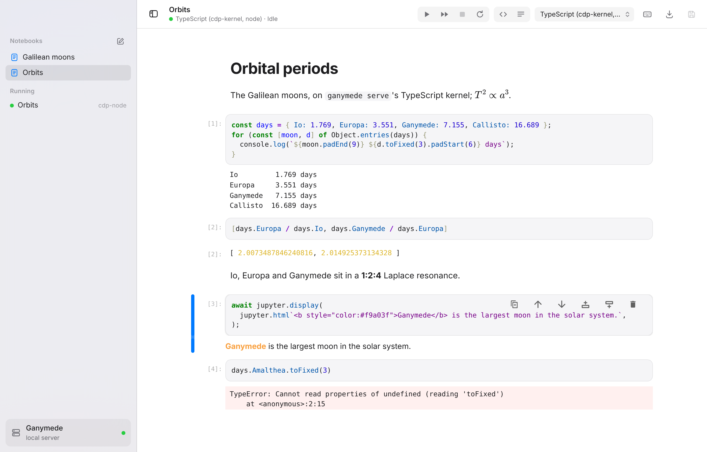
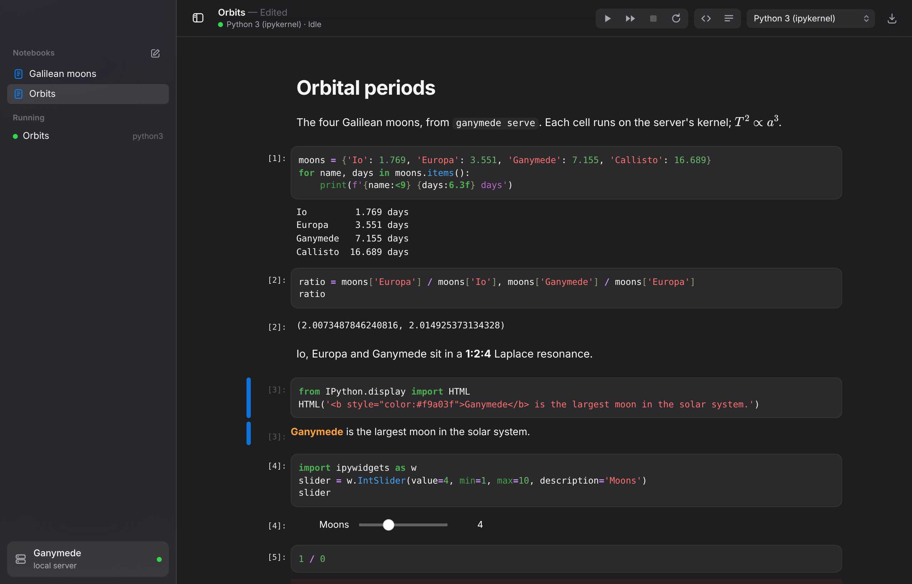
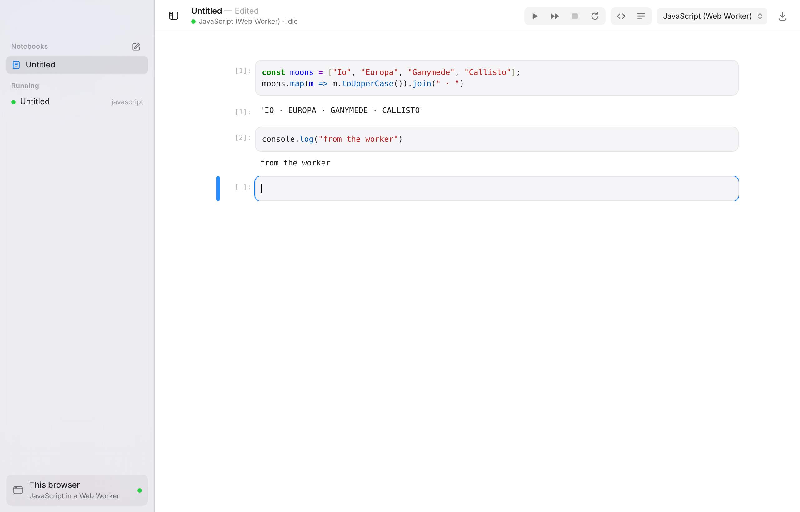
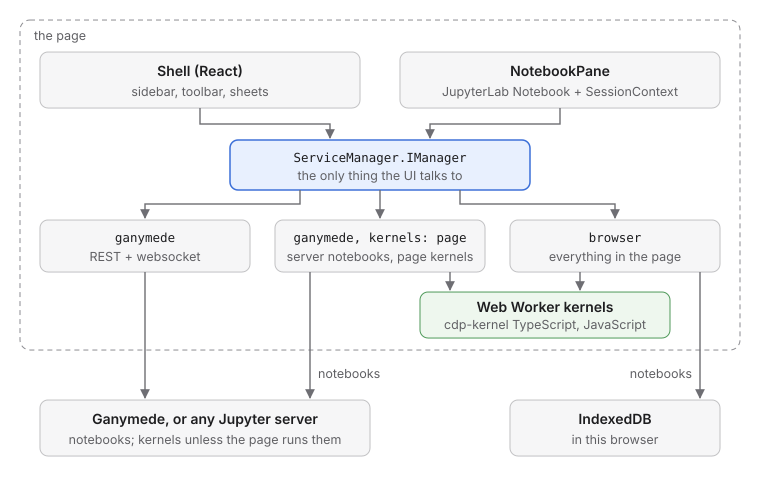

# ganymede-ui

A standalone notebook app for [Ganymede](https://github.com/tlockney/ganymede),
built on JupyterLab's notebook packages used directly as libraries, with Vite, styled to look like a macOS app, and
installable as a PWA. Kernels run either on a Ganymede server or in the
browser.

**Status:** working prototype. Runs notebooks against `ganymede serve` and
against in-browser kernels in a Web Worker: cdp-kernel's TypeScript kernel and
JupyterLite's JavaScript kernel. Started in
[tlockney/research](https://github.com/tlockney/research) and moved here with
its history.

[](https://github.com/tlockney/ganymede-ui/actions/workflows/ci.yml)

| Light                                                                                                                                                                                                                                          | Dark                                                                        |
| ---------------------------------------------------------------------------------------------------------------------------------------------------------------------------------------------------------------------------------------------- | --------------------------------------------------------------------------- |
|  |  |

_A notebook on `ganymede serve` running cdp-kernel's TypeScript kernel: stream, result, Markdown and math, HTML, and an error, saved._

<picture>
  <source media="(prefers-color-scheme: dark)" srcset="screenshots/browser-kernel-dark.png">
  
</picture>

_No server required: notebooks in the browser's storage, and the TypeScript kernel running in a Web Worker in the page._

## Where notebooks and kernels live



| Mode                      | Notebooks                         | Kernels                                                                                               |
| ------------------------- | --------------------------------- | ----------------------------------------------------------------------------------------------------- |
| Ganymede server           | Files in the folder it serves     | Any kernelspec installed on the server: TypeScript via cdp-kernel, Python via ipykernel, R, and so on |
| Ganymede, kernels in page | Files in the folder it serves     | The two in-browser kernels below                                                                      |
| This browser (no server)  | The browser's storage (IndexedDB) | cdp-kernel's TypeScript (the default) and JupyterLite's JavaScript, in a Web Worker                   |

There is no Python in the browser: no Pyodide, unlike JupyterLite. Python
runs only on a server, through an installed ipykernel. Compared with
JupyterLab, the web app is the notebook alone (a file list, the running
kernels, no terminals, consoles or extensions; the Mac and iPad apps add
terminals and a text editor); compared with JupyterLite, it also runs
against a real server.

## Download the Mac app

Each
[release](https://github.com/tlockney/ganymede-ui/releases) attaches
`Ganymede-macOS-<version>.zip`, a signed and notarized app that runs the
Ganymede server in its own process and can be the default app for
`.ipynb` files. It checks for new releases and installs them over
itself, asking first ([Updates](docs/apps.md#updates)). The iPad and
iPhone app is on TestFlight for internal testers. The latest build of
`main` is the
[`main-build`](https://github.com/tlockney/ganymede-ui/releases/tag/main-build)
prerelease, signed and notarized too ([apple/README.md](apple/README.md#download)). [docs/apps.md](docs/apps.md) is the apps' user guide;
[apple/README.md](apple/README.md) has how to build them.

## Run

You need Node.js 22.12 or later (CI uses 24). The server modes need
[Ganymede](https://ganymede-server.com/docs/install) 0.3.0 or later and a
kernel on it, such as cdp-kernel's TypeScript kernel, which Ganymede's
install script sets up.

```sh
ganymede serve --port 8888 --token test     # in a folder of notebooks
npm install
npm run dev                                 # http://localhost:5173/?token=test
```

The dev server proxies `/api` to `GANYMEDE_URL` (default
`http://127.0.0.1:8888`), so the page and the server share an origin. A token
in the page URL connects at once; otherwise a sheet asks where kernels run.
"This browser" needs no server at all. `npm run build && npm run preview`
(same proxy, port 4173) runs the production build, with offline use and
Workbox's service worker.

To use the app for real, have Ganymede serve the built app
(`ganymede serve --static-dir dist`, or a release), or host it anywhere
and connect it to a server with `--allow-origin`.
[docs/deploying.md](docs/deploying.md) has both setups step by step.

[`apple/`](apple/README.md) builds a Mac and an iPad/iPhone app that run
Ganymede in their own process and show this app in a web view. On the
iPad and iPhone, TypeScript cells get a `device` global for native
features such as the clipboard; [docs/device.md](docs/device.md) lists them.

## Using it

On a first run, the empty window says where notebooks live and where
kernels run, with buttons to show the folder and to change where kernels
run, and offers a sample notebook: a short TypeScript tour with
Markdown, a table and a plot, copied into the folder the sidebar shows
(as `Ganymede Tour.ipynb`, numbered if one is there already). "Don’t
Show Again" hides it in this browser (`ganymede-ui:onboarding` in local
storage).

### Example notebooks

**Open Example Notebooks**, under New Notebook in the empty window and in
the command palette (and in the apps' File menu), copies a set of
TypeScript notebooks into a new `Examples` folder in the folder the
sidebar shows, and opens the first. On iPhone and iPad the app's own
folder gets a copy on first launch (or the first after updating), so they
show without this step. They run on the TypeScript kernel and
were saved with their outputs, marked trusted:

| Notebook               | What it shows                                                        |
| :--------------------- | :------------------------------------------------------------------- |
| 01 Start Here          | Cells, state, and every kind of output                               |
| 02 Web APIs            | `fetch` from public APIs, tables, progress that updates in place     |
| 03 Charts and Diagrams | `jupyter.chart` with Vega-Lite and Observable Plot, d3, Graphviz     |
| 04 DuckDB              | `jupyter.sql` over CSV and Parquet by URL, results as tables, charts |
| 05 Generative Art      | Seeded randomness, `OffscreenCanvas` and SVG, animation              |
| 06 Widgets             | `jupyter.widget` (anywidget): controls that talk to the kernel       |
| 07 UI Frameworks       | React, Preact and Lit components as output                           |
| 08 Device              | The `device` API, each call checked with `device.has`                |

They load packages from esm.sh and data from public sites, so they need
a network connection. [examples/README.md](examples/README.md) says how
they are built.

Open a notebook from the sidebar, which also lists running kernels. The
toolbar runs, interrupts and restarts the kernel, switches kernels, trusts
the notebook, downloads it, and saves (⌘S). Keyboard shortcuts follow
JupyterLab's; press `H` in command mode (or the keyboard button) for the
full list. Every shortcut can be rebound there, and changes stay in this
browser. [docs/shortcuts.md](docs/shortcuts.md) lists the defaults.

In a narrow window, toolbar buttons that don't fit move into a "…" menu
at the toolbar's end, listed by name. Run always stays.

`⇧⌘P` (`Ctrl+Shift+P`), or the toolbar's command button, opens a command
palette: type to find any command, kernel or recent notebook, and press
`↩` to run it.

The toolbar's Variables button shows what the cells defined, beside the
notebook: name, type and a short value, read again after each run, with
objects that expand a level at a time. It needs a kernel that speaks the
Jupyter debugger protocol (cdp-kernel's Node and Deno kernels, ipykernel);
others say they can't list variables.

> [!NOTE]
> Memory needs a Ganymede with the metrics endpoint
> (tlockney/ganymede#361), which is 0.6.0 or later.

Each running kernel shows its memory beside its name, from the server's
jupyter-resource-usage endpoint, updated every few seconds while the
sidebar is open. A server without the endpoint, or a kernel running in
the page, shows none.

The search field at the top of the sidebar finds files by name in the
folder shown and its subfolders; tick "Search notebook contents" to also
search what the notebooks there say. It looks up to six folder levels
down and reads up to 200 notebooks, and says when it stopped early.
Above the folder, Recents lists the last eight notebooks you opened from
this browser, on each backend. The iPad and iPhone apps draw their own
sidebar, with the same search and Recents, though a folder in its results
doesn't open yet.

Below the folder, Outline lists the open notebook's Markdown headings,
indented by level; click one to select its cell and scroll to it. It
updates as you edit. The Mac app shows the same list in its sidebar's
Outline tab.

A notebook with unsaved edits saves itself every two minutes, when the
page is hidden, and when you open another file, and the browser asks before a tab with unsaved edits
closes. A failed save or kernel action shows its error above the notebook.

### Live editing on a Ganymede server

On a Ganymede server, including the apps' own, an open notebook joins the
server's [document room](https://ganymede-server.com/docs/rooms) for it. Edits
another client makes show up as they happen: a Claude session journaling
with the Ganymede Journal plugin or `ganymede mcp`, nb-cli, or the same
notebook in another window or in JupyterLab with the collaboration
extensions. The server saves the file a second after the last edit, and
takes in changes other programs make to it, merging them cell by cell, so
the notebook never locks. ⌘S asks the server to save at once; if the file
changed at the same time and its version of a cell won, the save says so.
If the server deletes the file, the notebook says its edits are no longer
saved.

### When the file changes on disk

Elsewhere (the browser's own storage, or a server without rooms) the
open notebook checks its file every few seconds and when the window
comes back. If another writer changed it, the notebook locks: nothing
saves it, not autosave, ⌘S, or opening another file, and the title says
"Locked". The notice above the notebook offers **Reload**, which loads
the new version and keeps the kernel running (it asks first if you have
unsaved edits, which it drops), and **Unlock**, which lets your copy save
over the version that locked it. A newer change locks it again.

When you have no unsaved edits and no cell is running, nothing here can be
lost, so the notebook takes the new version in place instead of locking:
the kernel keeps running and the scroll position stays.

### Code font

Settings > Code font picks the font of code cells, text outputs and code
in Markdown: the system's monospace font or one of the bundled fonts
(JetBrains Mono, Fira Code, Cascadia Code, Monaspace Neon, Argon, Xenon,
Radon and Krypton, Iosevka), all under the SIL Open Font License. Set the
size, turn ligatures off, and pick one of the font's styles: Standard, or
a few named sets of its alternates, such as JetBrains Mono's Slashed zero
or Iosevka's Menlo style. The preview shows the result before you save.
The page fetches only the font you pick.

Settings > Markdown font sets the font of text cells: System, Serif (the
font of pages from `ganymede nb publish`), or Monospace (the code font).

Both choices stay in this browser (`ganymede-ui:code-font` in local
storage); the Mac and iPad apps keep their own, in their Settings.

### Collapsing code

A code cell's chevron, left of its prompt (shown on hover and on the
active cell), collapses its code to the first line; the chevron or that
line expands it again. In command mode ⌘⌥[ and ⌘⌥] (Ctrl+Alt+[ and ]
elsewhere) collapse and expand the selected cells, and ⇧ with them does
every code cell; the command palette has all four, and on a phone the
cell's … menu has Collapse Code. A collapsed cell is saved that way in the
notebook (`metadata.jupyter.source_hidden`, as JupyterLab saves it).

### Running cells and errors

The cell the kernel is running says so under its input, with how long it
has run and an Interrupt button; cells waiting behind it say they are
queued. When something goes wrong, the notice above the notebook says
what happened and offers the next step: Restart when the kernel died,
Retry when the server couldn't be reached or a save failed, and a kernel
picker when the notebook's kernel isn't installed here.

When a Ganymede server reports memory use and the kernel's last reading,
taken in the few seconds before it died, had the machine nearly out of
memory (under 5% available) or the kernel holding over 90% of it, the
notice says the kernel ran out of memory.

## Where your data lives

- **This browser:** notebooks are stored in the browser's IndexedDB for this
  origin, and kernels run in the page. Nothing is sent anywhere. Clearing
  the site's data deletes the notebooks.
- **Ganymede:** notebooks are files in the folder the server serves, and
  kernels run where the server runs them.
- **The connection:** the chosen backend and server URL are saved in the
  browser's local storage (`ganymede-ui:backend`) and used on the next
  visit. The token is kept in session storage (`ganymede-ui:token`), which
  ends with the tab, so a new tab or a restarted browser asks for it
  again. Script on the page's origin can still read it while the tab is
  open. A `?token=` in the page URL is removed from the address bar once
  read. Served by Ganymede, the app connects on the login cookie and saves
  no token.
- **Trust:** Ganymede signs a notebook you trust, as Jupyter does, so its
  outputs render when reopened. The browser backend keeps no signatures, so
  trust lasts while the notebook is open.
- **Recents:** the paths of the notebooks you opened last, for each
  backend, are kept in local storage (`ganymede-ui:recents`) until you
  clear them from the sidebar.
- **Your name (Mac app):** the Mac app gives its own server your
  account's full name when it opens a notebook, so an agent working in
  the notebook is told who changed a cell; other clients with that
  notebook open there see it too. It never goes to a remote server.

Ganymede's [security page](https://ganymede-server.com/docs/security)
covers tokens, cookies and cross-origin access on the server side.

- **Agent keys:** the optional agent (Settings, off by default) keeps its
  provider, model and server URL in local storage (`ganymede-ui:agent`).
  An API key stays in session storage until the tab closes, or in local
  storage if you tick "Remember the key on this device". Either way,
  script on the page's origin can read it. In the Mac and iPad apps the
  key goes in the Keychain instead. Only pages from the app's server, in
  the window itself and not in output frames, can ask for it; an HTML
  file opened from the notebook folder doesn't count, since Ganymede
  sandboxes `/files`. The key is sent only to the provider you picked,
  straight from the page.
- **Error reports:** off by default. In a browser, Settings > "Send
  error reports" (kept in local storage, `ganymede-ui:crash-reports`); in
  the Mac and iPad apps, the app's own setting. When on, an unhandled
  error in the page's own code sends its type, message and stack, the
  release, and the browser and OS to Ganymede's Sentry. Breadcrumbs,
  URLs, host names, notebook content and errors from your own code (a
  notebook's JavaScript output) are left out in the page before anything
  is sent. Ganymede's [privacy page](https://ganymede-server.com/docs/privacy)
  has the rules for every part.

## Known gaps

It is a prototype. What it doesn't do yet, or does roughly:

- **Widgets run in the app's page.** Trusted HTML and JavaScript outputs
  render in sandboxed frames with no access to the app, and so do
  anywidget views (cdp-kernel's `jupyter.widget`), but ipywidgets'
  controls render in the page itself, where they could read the token
  from session storage while the tab is open. Relative
  links and images in trusted HTML outputs don't load, since the frame
  has no origin to resolve them against.
- **Switching backends** leaves the old backend's kernels running with no
  way to reach them from the app
  ([#62](https://github.com/tlockney/ganymede-ui/issues/62)).
- **File operations** are in the sidebar (rename, duplicate, delete, new
  folder) and the toolbar's title (rename the open notebook). A notebook
  dragged in from Finder or Files is copied into the sidebar's folder,
  and opened when dropped on the notebook; other files can't be uploaded
  yet.

- **Widgets** need a running kernel; saved widget state isn't restored
  without one.
- **The iPad and iPhone app** is on TestFlight for internal testers
  only, not the App Store.

[Issues](https://github.com/tlockney/ganymede-ui/issues) has the full list.

## How it fits together

In short below; [docs/architecture.md](docs/architecture.md) has the full
picture, and the Ganymede site shows it at
[ganymede-server.com/docs/ganymede-ui/architecture](https://ganymede-server.com/docs/ganymede-ui/architecture).

- **Backends** (`src/lib/backends.ts`). The UI only uses a
  `ServiceManager.IManager`. `ganymede` builds one over REST and websocket;
  `browser` builds JupyterLite's in-page server (`src/lib/lite.ts`,
  `@jupyterlite/services`) with two Web Worker kernels, storing notebooks in
  IndexedDB: cdp-kernel's TypeScript kernel (`src/lib/cdp-kernel.ts`, from
  `@tlockney/cdp-kernel/browser`), the default, and JupyterLite's JavaScript
  kernel (`@jupyterlite/javascript-kernel`). A `ganymede` connection with
  `kernels: 'page'` (the sheet's "Run kernels in this page", or
  `?kernels=page` in the URL) keeps notebooks on
  the server and runs these kernels in the page.
- **Notebook** (`src/components/NotebookPane.tsx`). JupyterLab's
  `Notebook` widget with a `SessionContext`, which starts or rejoins the
  file's kernel. The pane tracks status, and loads and saves nbformat
  through the contents API. `src/lib/jupyterlab.ts` builds what
  JupyterLab's plugins would: editor, renderers, executor, shortcuts,
  and Tab completion and Shift+Tab tooltips from the kernel, find
  (⌘F), and the cell toolbar. Trust Notebook in the toolbar renders
  untrusted outputs and signs the file on Ganymede.
  ipywidgets run through JupyterLab's widget manager (`src/lib/widgets.ts`),
  which also draws anywidget views, such as cdp-kernel's `jupyter.widget`,
  each in a sandboxed frame (`src/lib/anywidget.ts`).

- **Shell** (`src/components/`, `src/styles/app.css`). Unified toolbar,
  translucent source-list sidebar, sheets, segmented controls, system fonts
  and accent, light and dark from the system setting.
  `src/styles/jupyter.css` restyles JupyterLab through its CSS variables.
- **PWA** (`vite.config.ts`). Workbox precache, manifest with
  `window-controls-overlay`, Apple touch icon. `/api/` is never cached.
  The Workbox worker also carries JupyterLite's service-worker relay
  (`public/lite-service-worker.js`, `src/lib/lite-sw.ts`), which lets
  in-browser kernels read and write notebook files and ask for stdin
  synchronously; `npm run dev` registers the relay alone.

## Background

The app started on datalayer/jupyter-ui and moved to JupyterLab's packages
used directly, which cut the precached size from 8.3 MB to 5.5 MB; Ganymede
needed no changes to serve it. The [dev log](docs/notes.md) records each
step, what was checked, and what broke.

## Contributing

[CONTRIBUTING.md](CONTRIBUTING.md) has the commands (checks, tests,
end-to-end tests, releases) and how changes are made. Work is tracked in
[issues](https://github.com/tlockney/ganymede-ui/issues).
