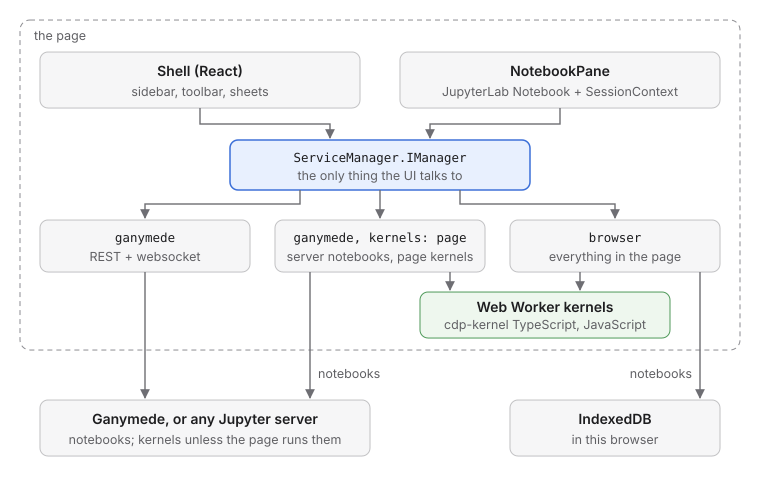
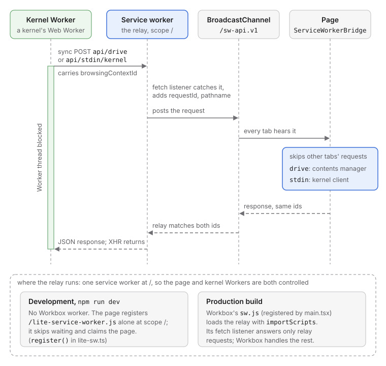
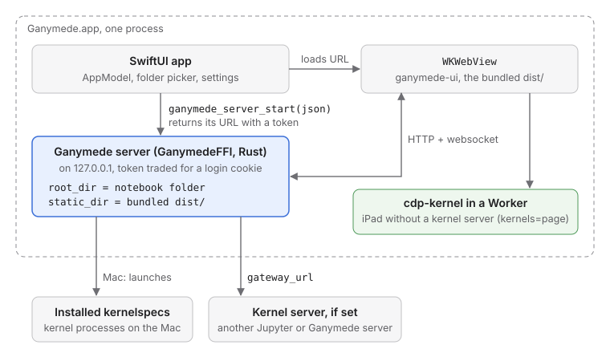

# Architecture

How ganymede-ui is put together: a web app built from JupyterLab's
notebook packages, a few ways to get kernels and notebooks, and a Mac and
iPad app that wrap it. This page describes `main`; the latest release may
not have all of it (see the [changelog](../CHANGELOG.md)).

ganymede-ui is a client of Ganymede's API, as the
[User interfaces](https://ganymede-server.com/docs/ui) page asks of any UI.
Nothing here is in Ganymede's Rust core, and the app runs against any
Jupyter server that speaks the same REST and websocket API.

## What it is built from

- **JupyterLab** is Jupyter's own web UI. Its features ship as npm
  packages: `@jupyterlab/notebook` (the notebook widget),
  `@jupyterlab/cells`, `@jupyterlab/rendermime` (output renderers),
  `@jupyterlab/codemirror` (the editor), and more. Inside JupyterLab they
  are loaded as plugins into an application built on **Lumino**,
  JupyterLab's toolkit for widgets, commands and plugins. ganymede-ui uses
  the packages as plain libraries instead, with no JupyterLab application:
  it renders the same notebook, and does by hand the wiring JupyterLab's
  plugins would do.
- **`@jupyterlab/services`** is the client half of the Jupyter server API
  (REST and websocket). Its `ServiceManager` bundles one manager each for
  contents (notebook files), kernels, sessions (which kernel belongs to
  which file) and kernelspecs (which kernels can be started). It is the
  only way ganymede-ui reaches notebooks and kernels.
- **JupyterLite** is Jupyter with no server: everything runs in the
  browser. Its `@jupyterlite/services` package answers the same server API
  from inside the page, stores files in the browser, and runs kernels in
  Web Workers, so `@jupyterlab/services` works against it unchanged.
  ganymede-ui uses only that package, not JupyterLite's application, to
  run kernels without a server: the rest of the app sees an ordinary
  `ServiceManager` and doesn't know the difference. This is how the
  browser mode works, and how the iPad app runs code (see
  [In-page server and kernels](#in-page-server-and-kernels)).
- **cdp-kernel** ([tlockney/cdp-kernel](https://github.com/tlockney/cdp-kernel))
  is a TypeScript and JavaScript kernel. Its browser build runs the kernel
  in the page with no Node or Deno, and is the default in-page kernel.
- **React** draws the app around the notebook (sidebar, toolbar, sheets),
  **Vite** builds it, and **Workbox**, a service-worker library, makes it
  an installable app that works offline (a PWA).

## The parts

| Part                             | Where                                                                                                                                                                       |
| -------------------------------- | --------------------------------------------------------------------------------------------------------------------------------------------------------------------------- |
| Backends                         | [`src/lib/backends.ts`](../src/lib/backends.ts)                                                                                                                             |
| In-page server and kernels       | [`src/lib/lite.ts`](../src/lib/lite.ts), [`src/lib/cdp-kernel.ts`](../src/lib/cdp-kernel.ts)                                                                                |
| Service-worker relay             | [`src/lib/lite-sw.ts`](../src/lib/lite-sw.ts), [`public/lite-service-worker.js`](../public/lite-service-worker.js)                                                          |
| Notebook                         | [`src/components/NotebookPane.tsx`](../src/components/NotebookPane.tsx), [`src/lib/jupyterlab.ts`](../src/lib/jupyterlab.ts), [`src/lib/widgets.ts`](../src/lib/widgets.ts) |
| Shell                            | [`src/App.tsx`](../src/App.tsx), [`src/components/`](../src/components/), [`src/styles/`](../src/styles/)                                                                   |
| Build and PWA                    | [`vite.config.ts`](../vite.config.ts)                                                                                                                                       |
| Agent (optional, off by default) | [`packages/agent/`](../packages/agent/), [`src/components/SettingsSheet.tsx`](../src/components/SettingsSheet.tsx)                                                          |
| Protocol package (not used yet)  | [`packages/client/`](../packages/client/)                                                                                                                                   |
| Mac and iPad app                 | [`apple/`](../apple/README.md)                                                                                                                                              |

## Backends

The UI talks to one object, a `ServiceManager.IManager` from
`@jupyterlab/services`: contents, kernels, sessions and kernelspecs.
Anything that can build one is a backend. `connect(config)` in
`backends.ts` builds it from a `BackendConfig`:

- **`ganymede`**: the stock `ServiceManager` over REST and websocket, at
  `url` with `token`. An empty `url` means this page's origin, which is how
  the app runs when Ganymede serves it (`ganymede serve --static-dir`,
  `ganymede ui`) and under `npm run dev`, whose proxy forwards `/api`.
  `connect` asks `api/status` first, so a wrong token fails with a message
  instead of a hung kernel list.
- **`ganymede` with `kernels: 'page'`**: notebooks on the server, kernels
  in this page. It builds the in-page server below with a `ContentsManager`
  pointed at the server. This is for a server that has no kernels of its
  own, such as the one inside the iPad app.
- **`browser`**: everything in the page. Notebooks are stored in IndexedDB,
  kernels run in Web Workers. Nothing is sent anywhere.

Where the app connects is decided in this order (`App.tsx`):

1. `?token=` or `?kernels=page|both|server` in the URL, as `ganymede serve`
   prints it and the Apple apps pass on every launch. They are removed from
   the address bar once read.
2. The connection saved in `localStorage` (`ganymede-ui:backend`), with
   its token from `sessionStorage` (`ganymede-ui:token`); the token never
   goes in `localStorage`.
3. A login cookie for this page's server: when `api/status` answers, the
   app connects to its own origin with no token.
4. Otherwise the connect sheet asks.

The URL can also say what to open, as an Apple app window opened on one
file does: `?open=<path>` opens that notebook once connected, with the
sidebar closed, and `?dir=<path>` is the folder the sidebar lists on that
first connection (by default the notebook's folder, or the server's root).
Paths are relative to the server's root; leading, trailing and repeated
`/` are dropped, so an absolute path works against a server rooted at `/`.
`readLaunch` (`src/lib/launch.ts`) reads both once. Both then stay in the
URL, kept in step with the open notebook and the folder the sidebar shows
(`dir` is left out when the page would start there anyway), so a reload
comes back to both. New notebooks go in the sidebar's folder. Picking
another backend in the connect sheet drops both; retrying the same server
there (say with a corrected token) keeps them. The page title is the open notebook's name.

Switching backends disposes the old `ServiceManager`. A server's kernels
keep running, as they do when a notebook closes, and show under Running
when the app connects to that server again. Kernels in the page have
nowhere to come back to, so the in-page manager shuts them down first,
which terminates their Workers.

## In-page server and kernels

This is the JupyterLite part: a stand-in for a Jupyter server that runs in
the page, so kernels can run with no server at all. JupyterLite's own
application assembles it from Lumino plugins. ganymede-ui has no plugin
system, so `createLiteServices` in `lite.ts` wires the same
`@jupyterlite/services` classes by hand and returns a `ServiceManager`, as
`connect` does for a real server:

- `LiteKernelClient`, `LiteSessionClient` and `LiteKernelSpecClient`
  answer the kernel, session and kernelspec APIs in the page. Kernel
  websockets are faked with `mock-socket`, a library that stands in for
  `WebSocket` inside the page.
- Contents come from `BrowserStorageDrive` (IndexedDB, the browser's
  database, through the `localforage` library), or from the server's `ContentsManager` in `kernels:
'page'` mode.
- Events and the user identity stay in the page (`LocalEvents`,
  `LocalUser`), since nothing answers `/api/events` or `/api/me` here.

Two kernels are registered:

- **TypeScript (cdp-kernel)**, `cdp-browser`, the default.
  `CdpBrowserKernel` wraps `startBrowserKernel` from
  `@tlockney/cdp-kernel/browser`: the kernel's message handling runs on the
  page and cells run in a module Worker. It answers every request itself,
  so messages pass through as Jupyter JSON. The wrapper copies the parent's
  session id into replies, which `LiteKernelClient` routes on, and
  `CdpAwareKernelClient` sends interrupts as an `interrupt_request`, since
  JupyterLite's own interrupt only cancels its message queue.
- **JavaScript (Web Worker)**, `javascript`, from
  `@jupyterlite/javascript-kernel`.

## Service-worker relay

A kernel in a Worker that needs a synchronous answer from the page (reading
or writing a notebook file, `input()`) makes a synchronous `XMLHttpRequest`
to `api/drive` or `api/stdin/kernel`. The page can't answer that directly,
so a service worker catches the request and relays it on the
`/sw-api.v1` `BroadcastChannel`. `ServiceWorkerBridge` in `lite-sw.ts`
answers on the page side: drive requests from the contents manager, stdin
from the kernel client. The kernel puts the page's `browsingContextId` in
each request and the relay adds a `requestId`; tabs and kernels share the
channel, so the bridge skips other pages' requests and the relay matches
the reply on both.

The Worker is blocked until its request is answered, so every request gets
an answer. The bridge answers `null` when a request fails, when it has no
handler for it, and, for whatever is still pending, when it is disposed.
The relay answers `null` itself when a drive request gets no answer in 30
seconds; stdin requests wait for a person, so they have no limit. DriveFS
turns `null` into `EINVAL`.

An origin has one service worker per scope, and the kernel Workers must be
controlled by it too, so the relay can't have a scope of its own. In the
production build Workbox's worker loads it with `importScripts`
(`vite.config.ts`); `npm run dev` has no Workbox worker and registers
`public/lite-service-worker.js` alone. The relay is the relay part of
JupyterLite's service worker, adapted.

## Notebook

`NotebookPane` shows one file. It holds JupyterLab's `Notebook` widget,
its `NotebookModel`, and a `SessionContext`, which rejoins the kernel
already running for the file but starts none on open: reading a notebook
shouldn't start a kernel. The first run (toolbar, Shift+Enter, any run
command) starts the kernel the file names, or the default when it names
none; until then the toolbar says the kernel "Starts when you run a cell",
and picking another kernel only changes which one that is. A kernel the
file names that isn't installed here (a Python notebook with no Python) is
not swapped for another: the toolbar shows it as not installed, and a run
asks for a kernel to be picked. It loads and saves nbformat
through the backend's contents API and gives the toolbar a
`NotebookController` (run, interrupt, restart, change kernel, save,
download, trust). A failed action shows its error in the pane.

`problems.ts` turns failures into what the pane's notice says: what
happened, and the next step as a button (Restart for a dead kernel,
Retry for an unreachable server, a lost kernel connection or a failed
save, a kernel picker for a missing kernelspec). Restarting a dead
kernel starts a new one of the same kind, since a dead kernel's
connection can't restart it. `run-status.ts` shows, on the cells, which
one the kernel is running (with its time and an Interrupt button) and
which are queued behind it. JupyterLab marks every cell sent to the
kernel as running, and a kernel runs them in order, so the first one
still marked is the one running.

> [!NOTE]
> **Unreleased.** The notice's next steps and the running and queued
> cells are available only from a build of `main` (HEAD), not in the
> latest release.

`NotebookSaver` (`saver.ts`) does the saving, as JupyterLab's document
context does: one save at a time, a check of the file's `last_modified`
before writing (a conflict when it is newer by more than 500 ms), and the
dirty flag cleared only if no edit arrived during the round trip. The
save sends the loaded `last_modified` too, which Ganymede checks again
under its save lock (409). The pane autosaves a dirty notebook every 120
seconds and when the page is hidden, and asks on `beforeunload`.

Inside JupyterLab, the editor, renderers and commands come from plugins.
`jupyterlab.ts` builds them once and shares them across notebooks: the
CodeMirror registries, a rendermime registry with JupyterLab's default
MIME extensions (Markdown, MathJax, JSON, JavaScript), the notebook
commands with JupyterLab's default shortcuts, and `attachEditing`, which
adds kernel completion (Tab), inspection tooltips (Shift+Tab), find and
the cell toolbar. Every binding is listed once in `shortcuts.ts`, which
also drives the shortcuts sheet and stores custom keys in `localStorage`.

ipywidgets load with the first notebook, as their own chunk
(`widgets.ts`). JupyterLab's widget plugin needs the application and a
document context, so the app uses `KernelWidgetManager`, the manager
JupyterLab uses for consoles, one per kernel. Widget state is written to
the notebook's metadata before each save.

Without a kernel, widgets render from that saved state, as nbviewer and VS
Code show them and JupyterLab doesn't: a manager with no kernel builds the
models without comms, so a slider moves and `jslink` holds, but nothing
reaches the kernel. When a kernel starts, its manager renders new outputs
and also loads the saved models the kernel doesn't have, as JupyterLab's
notebook manager does, so a save keeps them. Widget outputs drawn from the
saved state render again then, so a kernel the session rejoins drives them. The widget-view renderer is
not safe, as in JupyterLab (an HTML widget's value is HTML), so a notebook
nobody trusted shows its widgets' text until Trust Notebook.

Trust follows Jupyter's model: the server marks cells trusted when it serves
a signed notebook, and Trust Notebook in the toolbar calls
`POST /api/contents/{path}/trust`. The browser backend keeps no signatures,
so trust there lasts while the notebook is open.

Trusted HTML and JavaScript outputs don't render in the app's document, as
they do in JupyterLab: `output-frames.ts` swaps their renderers for ones
that put each output in an iframe with `sandbox` minus `allow-same-origin`
(an opaque origin: no cookies, storage or app DOM), a meta CSP, and the content
in `srcdoc`. The frame's one message out is its height, accepted only
from that frame's window. Untrusted HTML still renders in the page
through JupyterLab's sanitizer; Markdown outputs are always sanitized,
since trusted Markdown would run its HTML's scripts in the page; SVG
renders as an ``, untrusted too (JupyterLab refuses untrusted SVG,
which hid every SVG plot in a notebook made elsewhere), since an image
runs no scripts and loads nothing. ipywidgets still render in the page.

Long stream and error outputs scroll inside a box 32em high instead of
growing the notebook, and table cells use tabular figures so columns of
numbers line up. `e2e/reading.spec.ts` screenshots notebooks made
elsewhere (`e2e/fixtures/reading`, built by
`scripts/make-reading-fixtures.py` with a real Python kernel) in light and
dark, to check how the app reads them.

## Shell

React components in `src/components/` draw a macOS-style window: a
translucent source-list sidebar (the backend's files), a unified toolbar,
and sheets for connecting and for shortcuts. `src/styles/app.css` styles
the shell. JupyterLab's light and dark `--jp-*` variables follow the
system setting (`theme.ts`), and `src/styles/jupyter.css` overrides some of
them so the notebook matches the shell. Restyling through those variables
works; changing Lumino's layout does not, so the notebook scrolls itself.

## Build and PWA

Vite builds the app (`npm run build`, output in `dist/`). `vite.config.ts`
adapts a few webpack habits of JupyterLab's packages: SVG imports as
strings, `~pkg/` paths in stylesheets, and MathJax's CommonJS modules. It
also dedupes React (JupyterLab's packages bring React 18 copies of their
own) and pins the build target to Safari 16, the oldest web view the
Apple apps run in.

`vite-plugin-pwa` adds the manifest and a Workbox service worker that
precaches the app, so it works offline and installs as an app. `/api/` is
never cached. The release is this `dist/` as a static site
(`ganymede-ui-X.Y.Z.tar.gz` and `.zip`), which `ganymede ui install`
downloads; see [releasing](releasing.md).

## Agent

An optional agent (ganymede-ui#123) built on Pi Durable
(`@earendil-works/pi-durable`) lives in [`packages/agent`](../packages/agent/).
It is off by default and turned on in the Settings sheet (the sidebar's
settings button, or a `ganymede:show-settings` window event).

- `settings.ts` holds the settings (provider, model, a local server's URL)
  and the API keys. The app imports it up front, so it has no Pi runtime
  code. Settings go in `localStorage`; a key goes in `sessionStorage`, or
  `localStorage` when the person asks to remember it, behind pi-ai's
  `CredentialStore` interface. Keys never go in IndexedDB: kernel Workers
  on the page's origin can open IndexedDB but have no Web Storage. In the
  Apple apps, `KeychainCredentialStore` keeps keys in the Keychain behind
  the same interface: it asks the app's `agentKeys` script message
  handler, which answers only the main frame on the origin of the page
  the app loaded, and only for the four providers (ganymede-ui#166).
  Any page on that origin passes, including an HTML file served from
  `/files` until ganymede sandboxes it (ganymede#298), as it could read
  web storage before.
  The Settings sheet then shows no "Remember" choice.
- The iPad and iPhone apps edit the same settings on their own Settings
  screen (ganymede-ui#210): the app calls `window.ganymede.call`
  (`src/lib/native-agent.ts`) to read and save them, list a provider's
  models and run Test, and writes the key to the Keychain item the page
  reads. The page's Settings sheet stays for the browser and the Mac.

  > [!NOTE]
  > **Unreleased.** Available only from a build of `main` (HEAD), not in
  > the latest release, where the iPad and iPhone apps open the page's
  > Settings sheet.

- `models.ts` builds pi-ai's models for the chosen provider: Anthropic,
  OpenAI, Google, or a local OpenAI-compatible server (Ollama, LM Studio).
  The app loads it with a dynamic `import()` only when the agent is on.
  Its chunks, and chunks reached only through it, are named `agent-*`,
  and the PWA caches them on first use instead of precaching them for
  everyone.
- `index.ts` and `tools.ts` are the spike's harness and notebook tools
  (ganymede-ui#124); the agent panel that uses them comes next.

## Protocol package

[`packages/client`](../packages/client/) is Jupyter protocol code with no
UI framework: the v1 websocket framing, a connection layer, ANSI and
stream handling, and renderer and widget seams. It was Ganymede's
`frontend/` package. The app does not use it; it talks to servers through
`@jupyterlab/services`.

## Mac and iPad app

[`apple/`](../apple/README.md) is a SwiftUI app for macOS and iPadOS (and
iOS) built from one set of sources. XcodeGen generates the Xcode project
from `apple/project.yml`. It runs Ganymede in its
own process and shows this web app in a `WKWebView`:

- `GanymedeFFI.xcframework` is
  [`crates/ganymede-ffi`](https://github.com/tlockney/ganymede/tree/main/crates/ganymede-ffi)
  built for macOS and iOS. Its C API takes the server config as JSON (the
  keys of `ganymede.toml`), starts the server, and returns its URL with a
  token. `ServerHost.swift` wraps it.
- `AppModel.swift` starts the server with the bundled `dist/` as the
  static site, reusing the last port so the page keeps its origin and its
  `localStorage`. On the Mac it serves `/`, and each window
  (`WindowTarget.swift`) loads the page with `?open=` a notebook's absolute
  path or `?dir=` a folder's, so any file opens without a restart. On iOS
  it serves the chosen notebook folder. The server trades the token in the
  URL for a login cookie.
- The Mac app imports the `org.jupyter.ipynb` type (`.ipynb`, conforming
  to `public.json`) and declares it as a document type it edits, so the
  Finder offers it under Open With and it can be the default app for
  notebooks (Ganymede > Make Default App for Notebooks). Notebook windows
  are a `WindowGroup(for: WindowTarget.self)`: File > Open… and Open
  Folder… open a window per target, or bring the one already showing it to
  the front. Files opened from the Finder come to the app delegate's
  `application(_:open:)`, which queues them in `OpenRequests`; the first
  notebook window to see the queue takes it. The window the app opened on
  nothing at launch shows the first file, and the others open with
  `openWindow(value:)`, which brings forward a window already showing one.
  With no notebook window open, each file gets a new one.
- Two sandboxed app extensions give notebooks a Quick Look preview and a
  Finder thumbnail (`apple/Sources/QuickLook`). The preview shows
  `preview.html`, a page of its own (`vite build --mode quicklook`, about
  5 MB) that renders the file with this app's notebook view and
  rendermime, read-only and with every output untrusted, in a web view
  that loads it through a `ganymede-preview:` scheme handler: WebKit runs
  no module scripts from `file:` URLs, and there is no server. Its
  Content-Security-Policy loads nothing from the network. The thumbnail
  draws the first headings, code, and outputs (or the first PNG or JPEG)
  natively from the JSON, which is quicker than starting a web view.
- A notebook window acts as a document window (`DocumentWindow.swift`).
  The page posts `{ path, dirty }` to the `document` message handler
  (`src/lib/native.ts`) whenever the open notebook or its unsaved state
  changes. The window's `PageDocument` sets the proxy icon
  (`representedURL`) and the edited dot (`isDocumentEdited`), and adds the
  file to Open Recent (`NSDocumentController`). File > Save, and the Save /
  Don't Save prompts on close and quit, call `window.ganymede.save()` in
  the page with `callAsyncJavaScript`. That save returns whether the
  notebook was saved, so a failed save keeps the window open. The close
  prompt comes from a stand-in window delegate that forwards everything
  else to SwiftUI's.
- Native chrome (#205): loaded with `chrome=native`, the page shows only
  the notebook, with no sidebar or toolbar, so the app can draw its own.
  The page posts its `PageState` (open path, unsaved edits, kernel and its
  status, cell type, the kernels to pick from, the backend) to the `state`
  message handler whenever it changes, and the app runs commands with
  `window.ganymede.command(id, arg)`: the page's own (`PAGE_COMMANDS` in
  `src/lib/native.ts`: open, new-notebook, run, interrupt, cell-type, …)
  or any notebook command by its id in the shortcuts table. In the app,
  `PageModel` (`WebView.swift`) holds the state and runs the commands, and
  `PageCommand` builds the script with its arguments JSON-encoded. The Mac
  app loads every window this way (#206, #207): its sidebar reads the
  folder from disk with `FileManager`, not the contents API, since its
  server is rooted at `/` on the same machine, and its toolbar and Cell
  and Kernel menus run the page's commands. The iPad (#208) and iPhone
  (#209) load it this way too, with sidebar paths relative to the notebook
  folder, where their server is rooted. The iPhone's root screen is that
  folder list and the notebook is pushed onto it; its page lives in a
  `WebViewStore`, which keeps the `WKWebView` and its coordinator while
  the list shows, so going back doesn't reload the page and the list can
  run the page's commands.

  > [!NOTE]
  > **Unreleased.** Available only from a build of `main` (HEAD), not in
  > the latest release.

- `WebView.swift` handles what a browser would: links to other hosts open
  in the default browser, downloads ask where to save (the share sheet on
  iOS), and Help > Keyboard Shortcuts on the Mac sends
  `ganymede:show-shortcuts` to the page.
- `apple/scripts/bootstrap.sh` builds the XCFramework from a ganymede
  checkout and this repo's `dist/` into `apple/build/`, then generates the
  Xcode project. CI builds and tests both targets on macOS runners against
  the ganymede commit pinned in `GANYMEDE_REF` (`.github/workflows/ci.yml`).

Where kernels run:

| Run kernels on (⌘, or the server button) | Mac                                                     | iPad and iPhone                                     |
| ---------------------------------------- | ------------------------------------------------------- | --------------------------------------------------- |
| This device                              | Kernelspecs installed on the Mac                        | cdp-kernel in the kernel web view (`?kernels=page`) |
| A remote with a server                   | That server, through Ganymede's gateway (`gateway_url`) | Same                                                |

Both apps also list the page's own kernels beside the server's
(`?kernels=both`, `src/lib/mixed.ts`) whenever the server has kernels:
always on the Mac, and on the iPad when a remote runs kernels. Those
kernels run in the kernel web view below, the only place cells can reach
the app's bridges, such as ganymede-device's `device` (#185). One service
manager answers the UI: it merges the kernel specs (a page spec whose name
the server has is dropped), starts each kernel on the side that owns its
spec, routes later kernel and session calls by id, and opens a page
kernel's websocket on the page's fake server. Changing a notebook's
kernel to one on the other side starts its session again on the new side,
then ends it on the old one, under the same session id.

> [!NOTE]
> **Unreleased.** Available only from a build of `main` (HEAD), not in
> the latest release.

Settings keep a list of remotes (`Remote.swift`): each has a name, an
optional Jupyter or Ganymede server (its token in the keychain), and
optional SSH (host or ssh-config alias, user, port), for terminals. One
remote with a server can be chosen for kernels. The single kernel server
setting of earlier versions moves to the first remote on launch.

iOS does not let an app launch processes, so without a kernel server the
iPad's in-process Ganymede serves notebooks only and the page runs its own
kernel, the `kernels: 'page'` backend above. With a kernel server set,
Ganymede forwards kernel requests to it, and the page lists those kernels
beside its own (`kernels: 'both'`, above).
Notebooks stay on the device either way. On the Mac, an app opened from
the Finder takes `PATH` from the login shell (`LoginShell.swift`) so
kernelspecs that run `node`, `deno` or `python3` start.

In the apps, cdp-kernel's in-page kernels don't run in the UI's web view.
`KernelHost.swift` keeps a second, hidden web view on `kernel.html`
(`src/kernel-host.ts`), loaded from the same server when the first kernel
starts, and relays Jupyter messages between the two pages: the UI posts
to `webkit.messageHandlers.kernelRelay`, the kernel page to `kernelHost`,
and Swift delivers each to the other page's `deliver` in order
(`src/lib/kernel-relay.ts`; binary buffers travel as base64). Swift takes
only main-frame messages from the server's origin, since WebKit gives
subframes, the sandboxed output frames among them, the same handlers.
Native bridges for cells, such as
[ganymede-device](https://github.com/tlockney/ganymede-device)'s `device`
handler, belong on the kernel web view only, so nothing the UI renders
can call them (#99). When the kernel page sees a `device` handler, it
starts each kernel with ganymede-device's preload (which installs
`globalThis.device` in the cells' Worker), its `webkitHost()` and
`capabilities: { device: true }`. `KernelHost` registers ganymede-device's
Swift `DeviceBridge` on that web view, so cells in the app get `device`
(today `hello` and the clipboard; [Device API](device.md) is the
user's guide). `CdpBrowserKernel` uses the
relay whenever the page has a `kernelRelay` handler; a browser has none.

A native on-device kernel, cdp-kernel running in the app's process instead
of the web view, is planned and not started.

`Terminal/` holds the built-in terminal's pieces (#117): `TerminalSurface`,
a SwiftUI view over [SwiftTerm](https://github.com/migueldeicaza/SwiftTerm)'s
`TerminalView`, and `TerminalTransport`, which each source of a shell
implements. On the Mac, terminals live in the notebook window's bottom
panel (#248): `PanelController` holds the window's terminals, its
selection, whether the panel shows and its height, and `BottomPanel` draws
a `TerminalWindow` per terminal as a tab. Hidden terminals stay in the
view tree, so their sessions keep running; only the one on show has the
keyboard. File > New Terminal adds one to the panel, and File > New
Terminal Tab opens one as a tab of the window (#247). A
`JupyterTerminalTransport` creates a terminal through `/api/terminals` on
the app's own server, or on a remote's server, and speaks terminado's
websocket protocol to it. Closing the terminal's tab deletes it. For a
remote with SSH, `ProcessTerminalTransport` runs `/usr/bin/ssh` in a
pseudo-terminal the app spawns (SwiftTerm's `LocalProcess`), so OpenSSH
does everything it does in Terminal.app: ssh-config aliases, the agent,
ProxyJump, and asking to trust a new host key. iOS can't run a process,
so there `SSHTerminalTransport` speaks SSH in the app with Apple's
[swift-nio-ssh](https://github.com/apple/swift-nio-ssh): a pseudo-terminal
and shell on one session channel, signed in with the app's ed25519 key
(`SSHKey.swift`, in the keychain), and host keys trusted on first use per
remote (`HostKeyStore`). On iPad a terminal is its own scene
(`WindowGroup(for: TerminalRequest.self)`); SwiftTerm's key row gives Esc,
Ctrl, Tab and arrows on the software keyboard.

> [!NOTE]
> **Unreleased.** Available only from a build of `main` (HEAD), not in
> the latest release, where each Mac terminal opens in a window of its own.

`Editor/` is the text editor (#122). In the apps the page registers no
editor of its own: its sidebar enables files that aren't notebooks when
the app has an `openFile` message handler and the page uses the app's own
server, and posts the file's path there. The app opens an
`EditorWindow` (`WindowGroup(for: EditorRequest.self)`; a full-screen
cover on iPhone). `EditorDocument` reads and saves the file with
`TextFileClient`, through `/api/contents` with `format=text`, and polls
its `last_modified` every few seconds: a change on disk reloads the file,
or, with unsaved edits, shows a bar to keep either version. A save sends
`last_modified`, which Ganymede checks (409 on a conflict), and checks it
first itself, since `jupyter_server` doesn't. The text view is the
system's (`CodeTextView`, TextKit 1), so find, undo, input methods,
dictation and accessibility come with it. [Neon](https://github.com/ChimeHQ/Neon)
highlights it with tree-sitter grammars (`Highlighting`), coloring capture
names with system colors that follow light and dark. `CodeEditing` is
the typing help, as plain functions on the text that both platforms'
delegates call: Return keeps the indent and adds a level after an opener,
brackets and quotes pair, and backspace deletes an empty pair. The indent
is the file's own (tabs, or 2 or 4 spaces), else the language's.
`LineNumbers` draws the line numbers: an `NSRulerView` on the Mac, a
gutter inside the text view on iOS.

## Tests

Unit tests (Vitest, jsdom) sit next to the code as `*.test.ts(x)`. The
Playwright suite in `e2e/` runs the built app against a real
`ganymede serve` with cdp-kernel's `cdp-node` kernelspec, and no Python.
Swift tests are in `apple/Tests/`. See the [README](../README.md#run) for
the commands.
