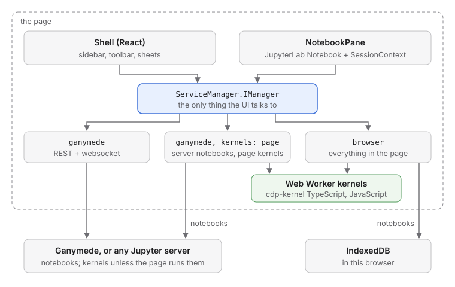
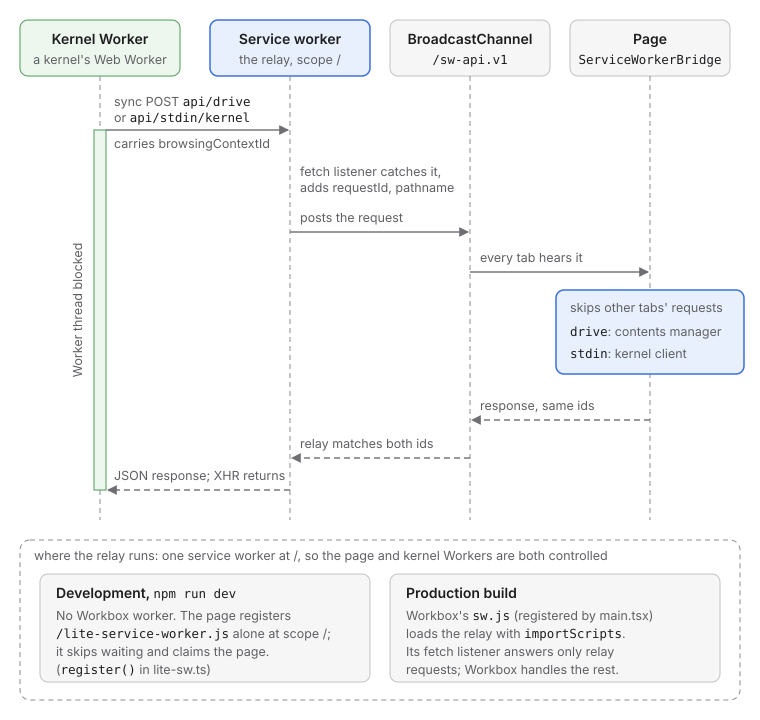
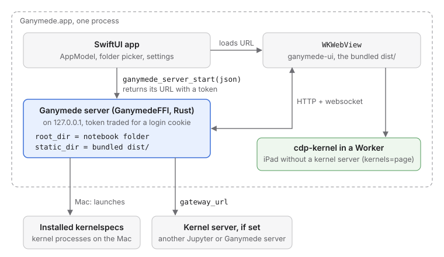

# Architecture

How ganymede-ui is put together: a web app built from JupyterLab's
notebook packages, a few ways to get kernels and notebooks, and a Mac and
iPad app that wrap it. This page describes `main`; the latest release may
not have all of it (see the [changelog](../CHANGELOG.md)).

ganymede-ui is a client of Ganymede's API, as the
[User interfaces](https://ganymede-server.com/docs/ui) page asks of any UI.
Nothing here is in Ganymede's Rust core, and the app runs against any
Jupyter server that speaks the same REST and websocket API.

## What it is built from

- **JupyterLab** is Jupyter's own web UI. Its features ship as npm
  packages: `@jupyterlab/notebook` (the notebook widget),
  `@jupyterlab/cells`, `@jupyterlab/rendermime` (output renderers),
  `@jupyterlab/codemirror` (the editor), and more. Inside JupyterLab they
  are loaded as plugins into an application built on **Lumino**,
  JupyterLab's toolkit for widgets, commands and plugins. ganymede-ui uses
  the packages as plain libraries instead, with no JupyterLab application:
  it renders the same notebook, and does by hand the wiring JupyterLab's
  plugins would do.
- **`@jupyterlab/services`** is the client half of the Jupyter server API
  (REST and websocket). Its `ServiceManager` bundles one manager each for
  contents (notebook files), kernels, sessions (which kernel belongs to
  which file) and kernelspecs (which kernels can be started). It is the
  only way ganymede-ui reaches notebooks and kernels.
- **JupyterLite** is Jupyter with no server: everything runs in the
  browser. Its `@jupyterlite/services` package answers the same server API
  from inside the page, stores files in the browser, and runs kernels in
  Web Workers, so `@jupyterlab/services` works against it unchanged.
  ganymede-ui uses only that package, not JupyterLite's application, to
  run kernels without a server: the rest of the app sees an ordinary
  `ServiceManager` and doesn't know the difference. This is how the
  browser mode works, and how the iPad app runs code (see
  [In-page server and kernels](#in-page-server-and-kernels)).
- **cdp-kernel** ([tlockney/cdp-kernel](https://github.com/tlockney/cdp-kernel))
  is a TypeScript and JavaScript kernel. Its browser build runs the kernel
  in the page with no Node or Deno, and is the default in-page kernel.
- **React** draws the app around the notebook (sidebar, toolbar, sheets),
  **Vite** builds it, and **Workbox**, a service-worker library, makes it
  an installable app that works offline (a PWA).

## The parts

| Part                             | Where                                                                                                                                                                       |
| -------------------------------- | --------------------------------------------------------------------------------------------------------------------------------------------------------------------------- |
| Backends                         | [`src/lib/backends.ts`](../src/lib/backends.ts)                                                                                                                             |
| In-page server and kernels       | [`src/lib/lite.ts`](../src/lib/lite.ts), [`src/lib/cdp-kernel.ts`](../src/lib/cdp-kernel.ts)                                                                                |
| Service-worker relay             | [`src/lib/lite-sw.ts`](../src/lib/lite-sw.ts), [`public/lite-service-worker.js`](../public/lite-service-worker.js)                                                          |
| Notebook                         | [`src/components/NotebookPane.tsx`](../src/components/NotebookPane.tsx), [`src/lib/jupyterlab.ts`](../src/lib/jupyterlab.ts), [`src/lib/widgets.ts`](../src/lib/widgets.ts) |
| Shell                            | [`src/App.tsx`](../src/App.tsx), [`src/components/`](../src/components/), [`src/styles/`](../src/styles/)                                                                   |
| Build and PWA                    | [`vite.config.ts`](../vite.config.ts)                                                                                                                                       |
| Agent (optional, off by default) | [`packages/agent/`](../packages/agent/), [`src/components/SettingsSheet.tsx`](../src/components/SettingsSheet.tsx)                                                          |
| Protocol package (not used yet)  | [`packages/client/`](../packages/client/)                                                                                                                                   |
| Mac and iPad app                 | [`apple/`](../apple/README.md)                                                                                                                                              |

## Backends

The UI talks to one object, a `ServiceManager.IManager` from
`@jupyterlab/services`: contents, kernels, sessions and kernelspecs.
Anything that can build one is a backend. `connect(config)` in
`backends.ts` builds it from a `BackendConfig`:

- **`ganymede`**: the stock `ServiceManager` over REST and websocket, at
  `url` with `token`. An empty `url` means this page's origin, which is how
  the app runs when Ganymede serves it (`ganymede serve --static-dir`,
  `ganymede ui`) and under `npm run dev`, whose proxy forwards `/api`.
  `connect` asks `api/status` first, so a wrong token fails with a message
  instead of a hung kernel list.
- **`ganymede` with `kernels: 'page'`**: notebooks on the server, kernels
  in this page. It builds the in-page server below with a `ContentsManager`
  pointed at the server. This is for a server that has no kernels of its
  own, such as the one inside the iPad app.
- **`browser`**: everything in the page. Notebooks are stored in IndexedDB,
  kernels run in Web Workers. Nothing is sent anywhere.

Where the app connects is decided in this order (`App.tsx`):

1. `?token=` or `?kernels=page|server` in the URL, as `ganymede serve`
   prints it and the Apple apps pass on every launch. They are removed from
   the address bar once read.
2. The connection saved in `localStorage` (`ganymede-ui:backend`), with
   its token from `sessionStorage` (`ganymede-ui:token`); the token never
   goes in `localStorage`.
3. A login cookie for this page's server: when `api/status` answers, the
   app connects to its own origin with no token.
4. Otherwise the connect sheet asks.

> [!NOTE]
> **Unreleased.** The token in `sessionStorage`, `?open=` and `?dir=`, and
> server kernels that keep running after a backend switch are available
> only from a build of `main` (HEAD), not in the latest release.

The URL can also say what to open, as an Apple app window opened on one
file does: `?open=<path>` opens that notebook once connected, with the
sidebar closed, and `?dir=<path>` is the folder the sidebar lists on that
first connection (by default the notebook's folder, or the server's root).
Paths are relative to the server's root; leading, trailing and repeated
`/` are dropped, so an absolute path works against a server rooted at `/`.
`readLaunch` (`src/lib/launch.ts`) reads both once. `dir` is removed with
the others; `open` is then kept in step with the open notebook, so a
reload comes back to it. Picking another backend in the connect sheet
drops both; retrying the same server there (say with a corrected token)
keeps them. The page title is the open notebook's name.

Switching backends disposes the old `ServiceManager`. A server's kernels
keep running, as they do when a notebook closes, and show under Running
when the app connects to that server again. Kernels in the page have
nowhere to come back to, so the in-page manager shuts them down first,
which terminates their Workers.

## In-page server and kernels

This is the JupyterLite part: a stand-in for a Jupyter server that runs in
the page, so kernels can run with no server at all. JupyterLite's own
application assembles it from Lumino plugins. ganymede-ui has no plugin
system, so `createLiteServices` in `lite.ts` wires the same
`@jupyterlite/services` classes by hand and returns a `ServiceManager`, as
`connect` does for a real server:

- `LiteKernelClient`, `LiteSessionClient` and `LiteKernelSpecClient`
  answer the kernel, session and kernelspec APIs in the page. Kernel
  websockets are faked with `mock-socket`, a library that stands in for
  `WebSocket` inside the page.
- Contents come from `BrowserStorageDrive` (IndexedDB, the browser's
  database, through the `localforage` library), or from the server's `ContentsManager` in `kernels:
'page'` mode.
- Events and the user identity stay in the page (`LocalEvents`,
  `LocalUser`), since nothing answers `/api/events` or `/api/me` here.

Two kernels are registered:

- **TypeScript (cdp-kernel)**, `cdp-browser`, the default.
  `CdpBrowserKernel` wraps `startBrowserKernel` from
  `@tlockney/cdp-kernel/browser`: the kernel's message handling runs on the
  page and cells run in a module Worker. It answers every request itself,
  so messages pass through as Jupyter JSON. The wrapper copies the parent's
  session id into replies, which `LiteKernelClient` routes on, and
  `CdpAwareKernelClient` sends interrupts as an `interrupt_request`, since
  JupyterLite's own interrupt only cancels its message queue.
- **JavaScript (Web Worker)**, `javascript`, from
  `@jupyterlite/javascript-kernel`.

## Service-worker relay

A kernel in a Worker that needs a synchronous answer from the page (reading
or writing a notebook file, `input()`) makes a synchronous `XMLHttpRequest`
to `api/drive` or `api/stdin/kernel`. The page can't answer that directly,
so a service worker catches the request and relays it on the
`/sw-api.v1` `BroadcastChannel`. `ServiceWorkerBridge` in `lite-sw.ts`
answers on the page side: drive requests from the contents manager, stdin
from the kernel client. The kernel puts the page's `browsingContextId` in
each request and the relay adds a `requestId`; tabs and kernels share the
channel, so the bridge skips other pages' requests and the relay matches
the reply on both.

The Worker is blocked until its request is answered, so every request gets
an answer. The bridge answers `null` when a request fails, when it has no
handler for it, and, for whatever is still pending, when it is disposed.
The relay answers `null` itself when a drive request gets no answer in 30
seconds; stdin requests wait for a person, so they have no limit. DriveFS
turns `null` into `EINVAL`.

An origin has one service worker per scope, and the kernel Workers must be
controlled by it too, so the relay can't have a scope of its own. In the
production build Workbox's worker loads it with `importScripts`
(`vite.config.ts`); `npm run dev` has no Workbox worker and registers
`public/lite-service-worker.js` alone. The relay is the relay part of
JupyterLite's service worker, adapted.

## Notebook

> [!NOTE]
> **Unreleased.** Starting the kernel on the first run, `NotebookSaver` and
> autosave, sandboxed output frames, and the reading screenshots are
> available only from a build of `main` (HEAD), not in the latest release.

`NotebookPane` shows one file. It holds JupyterLab's `Notebook` widget,
its `NotebookModel`, and a `SessionContext`, which rejoins the kernel
already running for the file but starts none on open: reading a notebook
shouldn't start a kernel. The first run (toolbar, Shift+Enter, any run
command) starts the kernel the file names, or the default when it names
none; until then the toolbar says the kernel "Starts when you run a cell",
and picking another kernel only changes which one that is. A kernel the
file names that isn't installed here (a Python notebook with no Python) is
not swapped for another: the toolbar shows it as not installed, and a run
asks for a kernel to be picked. It loads and saves nbformat
through the backend's contents API and gives the toolbar a
`NotebookController` (run, interrupt, restart, change kernel, save,
download, trust). A failed action shows its error in the pane.

`NotebookSaver` (`saver.ts`) does the saving, as JupyterLab's document
context does: one save at a time, a check of the file's `last_modified`
before writing (a conflict when it is newer by more than 500 ms), and the
dirty flag cleared only if no edit arrived during the round trip. The
save sends the loaded `last_modified` too, which Ganymede checks again
under its save lock (409). The pane autosaves a dirty notebook every 120
seconds and when the page is hidden, and asks on `beforeunload`.

Inside JupyterLab, the editor, renderers and commands come from plugins.
`jupyterlab.ts` builds them once and shares them across notebooks: the
CodeMirror registries, a rendermime registry with JupyterLab's default
MIME extensions (Markdown, MathJax, JSON, JavaScript), the notebook
commands with JupyterLab's default shortcuts, and `attachEditing`, which
adds kernel completion (Tab), inspection tooltips (Shift+Tab), find and
the cell toolbar. Every binding is listed once in `shortcuts.ts`, which
also drives the shortcuts sheet and stores custom keys in `localStorage`.

ipywidgets load with the first notebook, as their own chunk
(`widgets.ts`). JupyterLab's widget plugin needs the application and a
document context, so the app uses `KernelWidgetManager`, the manager
JupyterLab uses for consoles, one per kernel. Widget state is written to
the notebook's metadata before each save.

Trust follows Jupyter's model: the server marks cells trusted when it serves
a signed notebook, and Trust Notebook in the toolbar calls
`POST /api/contents/{path}/trust`. The browser backend keeps no signatures,
so trust there lasts while the notebook is open.

Trusted HTML and JavaScript outputs don't render in the app's document, as
they do in JupyterLab: `output-frames.ts` swaps their renderers for ones
that put each output in an iframe with `sandbox` minus `allow-same-origin`
(an opaque origin: no cookies, storage or app DOM), a meta CSP, and the content
in `srcdoc`. The frame's one message out is its height, accepted only
from that frame's window. Untrusted HTML still renders in the page
through JupyterLab's sanitizer; Markdown outputs are always sanitized,
since trusted Markdown would run its HTML's scripts in the page; SVG
renders as an ``, untrusted too (JupyterLab refuses untrusted SVG,
which hid every SVG plot in a notebook made elsewhere), since an image
runs no scripts and loads nothing. ipywidgets still render in the page.

Long stream and error outputs scroll inside a box 32em high instead of
growing the notebook, and table cells use tabular figures so columns of
numbers line up. `e2e/reading.spec.ts` screenshots notebooks made
elsewhere (`e2e/fixtures/reading`, built by
`scripts/make-reading-fixtures.py` with a real Python kernel) in light and
dark, to check how the app reads them.

## Shell

React components in `src/components/` draw a macOS-style window: a
translucent source-list sidebar (the backend's files), a unified toolbar,
and sheets for connecting and for shortcuts. `src/styles/app.css` styles
the shell. JupyterLab's light and dark `--jp-*` variables follow the
system setting (`theme.ts`), and `src/styles/jupyter.css` overrides some of
them so the notebook matches the shell. Restyling through those variables
works; changing Lumino's layout does not, so the notebook scrolls itself.

## Build and PWA

Vite builds the app (`npm run build`, output in `dist/`). `vite.config.ts`
adapts a few webpack habits of JupyterLab's packages: SVG imports as
strings, `~pkg/` paths in stylesheets, a `require` of `package.json` in
`@jupyter-widgets/controls`, and MathJax's CommonJS modules.

`vite-plugin-pwa` adds the manifest and a Workbox service worker that
precaches the app, so it works offline and installs as an app. `/api/` is
never cached. The release is this `dist/` as a static site
(`ganymede-ui-X.Y.Z.tar.gz` and `.zip`), which `ganymede ui install`
downloads; see [releasing](releasing.md).

## Agent

An optional agent (ganymede-ui#123) built on Pi Durable
(`@earendil-works/pi-durable`) lives in [`packages/agent`](../packages/agent/).
It is off by default and turned on in the Settings sheet (the sidebar's
settings button, or a `ganymede:show-settings` window event).

- `settings.ts` holds the settings (provider, model, a local server's URL)
  and the API keys. The app imports it up front, so it has no Pi runtime
  code. Settings go in `localStorage`; a key goes in `sessionStorage`, or
  `localStorage` when the person asks to remember it, behind pi-ai's
  `CredentialStore` interface. Keys never go in IndexedDB: kernel Workers
  on the page's origin can open IndexedDB but have no Web Storage. The
  Apple apps will keep keys in the Keychain behind the same interface
  (ganymede-ui#166).
- `models.ts` builds pi-ai's models for the chosen provider: Anthropic,
  OpenAI, Google, or a local OpenAI-compatible server (Ollama, LM Studio).
  The app loads it with a dynamic `import()` only when the agent is on.
  Its chunks are named `agent-*`, and the PWA caches them on first use
  instead of precaching them for everyone.
- `index.ts` and `tools.ts` are the spike's harness and notebook tools
  (ganymede-ui#124); the agent panel that uses them comes next.

> [!NOTE]
> **Unreleased.** The Settings sheet and agent settings are available only
> from a build of `main` (HEAD), not in the latest release.

## Protocol package

[`packages/client`](../packages/client/) is Jupyter protocol code with no
UI framework: the v1 websocket framing, a connection layer, ANSI and
stream handling, and renderer and widget seams. It was Ganymede's
`frontend/` package. The app does not use it; it talks to servers through
`@jupyterlab/services`.

## Mac and iPad app

[`apple/`](../apple/README.md) is a SwiftUI app for macOS and iPadOS (and
iOS) built from one set of sources. XcodeGen generates the Xcode project
from `apple/project.yml`. It runs Ganymede in its
own process and shows this web app in a `WKWebView`:

> [!NOTE]
> **Unreleased.** Notebook windows and the `.ipynb` document type,
> remotes, the hidden kernel web view, and the terminal are available only
> from a build of `main` (HEAD), not in the latest release.

- `GanymedeFFI.xcframework` is
  [`crates/ganymede-ffi`](https://github.com/tlockney/ganymede/tree/main/crates/ganymede-ffi)
  built for macOS and iOS. Its C API takes the server config as JSON (the
  keys of `ganymede.toml`), starts the server, and returns its URL with a
  token. `ServerHost.swift` wraps it.
- `AppModel.swift` starts the server with the bundled `dist/` as the
  static site, reusing the last port so the page keeps its origin and its
  `localStorage`. On the Mac it serves `/`, and each window
  (`WindowTarget.swift`) loads the page with `?open=` a notebook's absolute
  path or `?dir=` a folder's, so any file opens without a restart. On iOS
  it serves the chosen notebook folder. The server trades the token in the
  URL for a login cookie.
- The Mac app imports the `org.jupyter.ipynb` type (`.ipynb`, conforming
  to `public.json`) and declares it as a document type it edits, so the
  Finder offers it under Open With and it can be the default app for
  notebooks (Ganymede > Make Default App for Notebooks). Notebook windows
  are a `WindowGroup(for: WindowTarget.self)`: File > Open… and Open
  Folder… open a window per target, or bring the one already showing it to
  the front; a file opened from the Finder arrives through `onOpenURL` in a
  new window, or in the window already showing that file
  (`handlesExternalEvents`).
- A notebook window acts as a document window (`DocumentWindow.swift`).
  The page posts `{ path, dirty }` to the `document` message handler
  (`src/lib/native.ts`) whenever the open notebook or its unsaved state
  changes. The window's `PageDocument` sets the proxy icon
  (`representedURL`) and the edited dot (`isDocumentEdited`), and adds the
  file to Open Recent (`NSDocumentController`). File > Save, and the Save /
  Don't Save prompts on close and quit, call `window.ganymede.save()` in
  the page with `callAsyncJavaScript`. That save returns whether the
  notebook was saved, so a failed save keeps the window open. The close
  prompt comes from a stand-in window delegate that forwards everything
  else to SwiftUI's.
- `WebView.swift` handles what a browser would: links to other hosts open
  in the default browser, downloads ask where to save (the share sheet on
  iOS), and Help > Keyboard Shortcuts on the Mac sends
  `ganymede:show-shortcuts` to the page.
- `apple/scripts/bootstrap.sh` builds the XCFramework from a ganymede
  checkout and this repo's `dist/` into `apple/build/`, then generates the
  Xcode project. CI builds and tests both targets on macOS runners against
  the ganymede commit pinned in `GANYMEDE_REF` (`.github/workflows/ci.yml`).

Where kernels run:

| Run kernels on (⌘, or the server button) | Mac                                                     | iPad and iPhone                                     |
| ---------------------------------------- | ------------------------------------------------------- | --------------------------------------------------- |
| This device                              | Kernelspecs installed on the Mac                        | cdp-kernel in the kernel web view (`?kernels=page`) |
| A remote with a server                   | That server, through Ganymede's gateway (`gateway_url`) | Same                                                |

Settings keep a list of remotes (`Remote.swift`): each has a name, an
optional Jupyter or Ganymede server (its token in the keychain), and
optional SSH (host or ssh-config alias, user, port), for terminals. One
remote with a server can be chosen for kernels. The single kernel server
setting of earlier versions moves to the first remote on launch.

iOS does not let an app launch processes, so without a kernel server the
iPad's in-process Ganymede serves notebooks only and the page runs its own
kernel, the `kernels: 'page'` backend above. With a kernel server set,
Ganymede forwards kernel requests to it and the page connects as usual.
Notebooks stay on the device either way. On the Mac, an app opened from
the Finder takes `PATH` from the login shell (`LoginShell.swift`) so
kernelspecs that run `node`, `deno` or `python3` start.

In the apps, cdp-kernel's in-page kernels don't run in the UI's web view.
`KernelHost.swift` keeps a second, hidden web view on `kernel.html`
(`src/kernel-host.ts`), loaded from the same server when the first kernel
starts, and relays Jupyter messages between the two pages: the UI posts
to `webkit.messageHandlers.kernelRelay`, the kernel page to `kernelHost`,
and Swift delivers each to the other page's `deliver` in order
(`src/lib/kernel-relay.ts`; binary buffers travel as base64). Swift takes
only main-frame messages from the server's origin, since WebKit gives
subframes, the sandboxed output frames among them, the same handlers.
Native bridges for cells, such as
[ganymede-device](https://github.com/tlockney/ganymede-device)'s `device`
handler, belong on the kernel web view only, so nothing the UI renders
can call them (#99). When the kernel page sees a `device` handler, it
starts each kernel with ganymede-device's preload (which installs
`globalThis.device` in the cells' Worker), its `webkitHost()` and
`capabilities: { device: true }`. `KernelHost` registers ganymede-device's
Swift `DeviceBridge` on that web view, so cells in the app get `device`
(today `hello` and the clipboard). `CdpBrowserKernel` uses the
relay whenever the page has a `kernelRelay` handler; a browser has none.

A native on-device kernel, cdp-kernel running in the app's process instead
of the web view, is planned and not started.

`Terminal/` holds the built-in terminal's pieces (#117): `TerminalSurface`,
a SwiftUI view over [SwiftTerm](https://github.com/migueldeicaza/SwiftTerm)'s
`TerminalView`, and `TerminalTransport`, which each source of a shell
implements. On the Mac, File > New Terminal opens a `TerminalWindow` whose
`JupyterTerminalTransport` creates a terminal through `/api/terminals` on
the app's own server, or on a remote's server, and speaks terminado's
websocket protocol to it. Closing the window deletes the terminal. For
a remote with SSH, `ProcessTerminalTransport` runs `/usr/bin/ssh` in a
pseudo-terminal the app spawns (SwiftTerm's `LocalProcess`), so OpenSSH
does everything it does in Terminal.app: ssh-config aliases, the agent,
ProxyJump, and asking to trust a new host key. iOS can't run a process,
so there `SSHTerminalTransport` speaks SSH in the app with Apple's
[swift-nio-ssh](https://github.com/apple/swift-nio-ssh): a pseudo-terminal
and shell on one session channel, signed in with the app's ed25519 key
(`SSHKey.swift`, in the keychain), and host keys trusted on first use per
remote (`HostKeyStore`). On iPad a terminal is its own scene
(`WindowGroup(for: TerminalRequest.self)`); SwiftTerm's key row gives Esc,
Ctrl, Tab and arrows on the software keyboard.

## Tests

Unit tests (Vitest, jsdom) sit next to the code as `*.test.ts(x)`. The
Playwright suite in `e2e/` runs the built app against a real
`ganymede serve` with cdp-kernel's `cdp-node` kernelspec, and no Python.
Swift tests are in `apple/Tests/`. See the [README](../README.md#run) for
the commands.
