# Mac redesign: the mockups and how they got here

The visual redesign of the apps ([#844](https://github.com/tlockney/ganymede-ui/issues/844))
started from mockups on a design canvas
([claude.ai artifact](https://claude.ai/artifact/UTu4T7MEKjez8y3ZsJarC6)).
This folder keeps them in the repository
([#895](https://github.com/tlockney/ganymede-ui/issues/895)), so the
reasoning survives the canvas.

- `boards/`: each board rendered at its canvas size (2×, JPEG).
- `source/`: each board's HTML as the canvas exported it, standalone.
  Open one in a browser to see it live. The fonts come from Google Fonts.
- `app/`: the Mac app at the end of step 4b, for comparison with the
  chosen board.

The canvas went through five rounds on 26 and 27 November 2026: what was
wrong with v0.17.1, four directions, a choice, a review of the choice,
and a board for one step (the sidebar). Each is below, in order.

## 1. What read as bland in v0.17.1

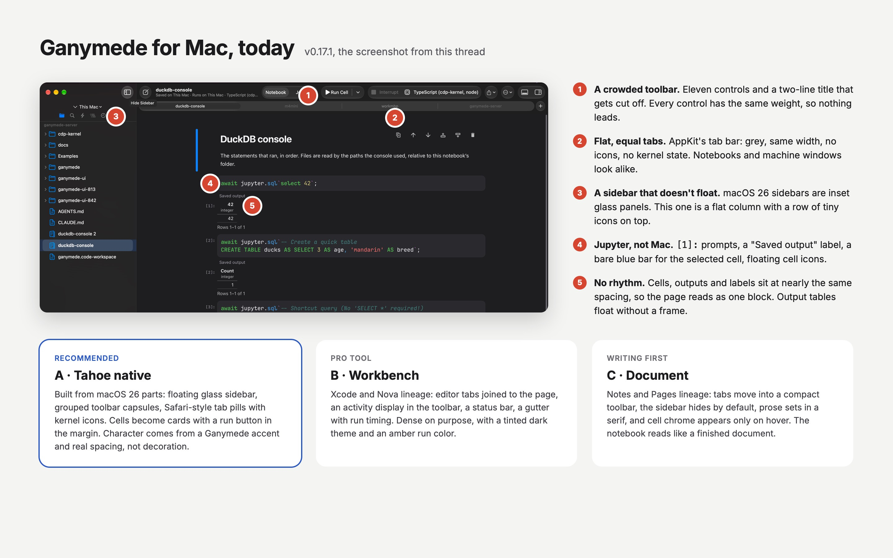

Thomas, on v0.17.1: the notebook UI was "bland and boring", didn't feel
native, felt "compressed or squashed", and the tabs didn't stand out. The
first board pins that down to five things:

1. A crowded toolbar: eleven controls of equal weight, and a two-line
   title that gets cut off.
2. Flat, equal tabs: AppKit's grey tab bar, no icons, no kernel state;
   notebooks and machine windows look alike.
3. A sidebar that doesn't float as macOS 26 sidebars do, with a row of
   tiny icons on top.
4. Cells that look like Jupyter, not a Mac app: `[1]:` prompts, a "Saved
   output" label, a bare blue bar on the selected cell, floating icons.
5. No spacing rhythm: cells, outputs and labels at nearly the same
   spacing, so the page reads as one block.

## 2. Four directions

Each direction has a Mac board and a board for iPad and iPhone.

### A · Tahoe native (recommended)

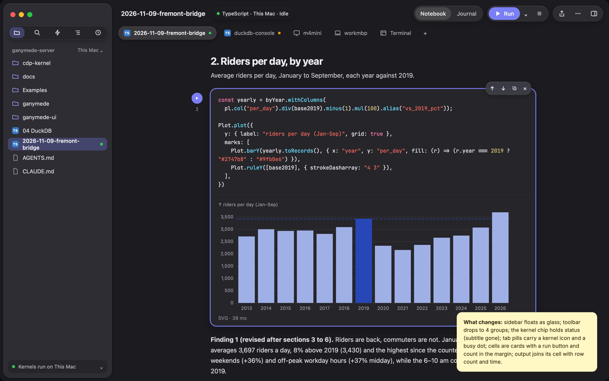

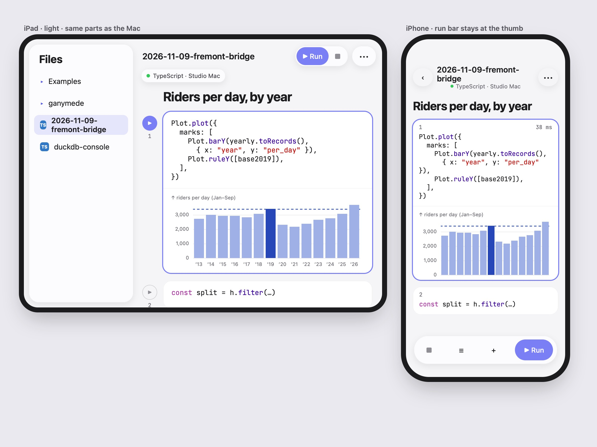

Built from macOS 26 parts. The sidebar floats as glass, the toolbar drops
to four groups, and a kernel chip holds the kernel's state in place of the
subtitle. Tab pills carry a kernel icon and a busy dot. Cells become cards
with a run button and the execution count in the margin, and each output
joins its cell with its row count and time. Character comes from one
accent and real spacing, not decoration.

### B · Workbench

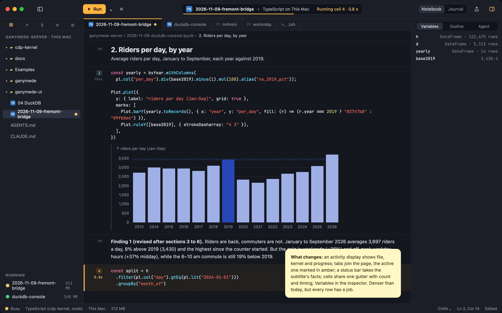

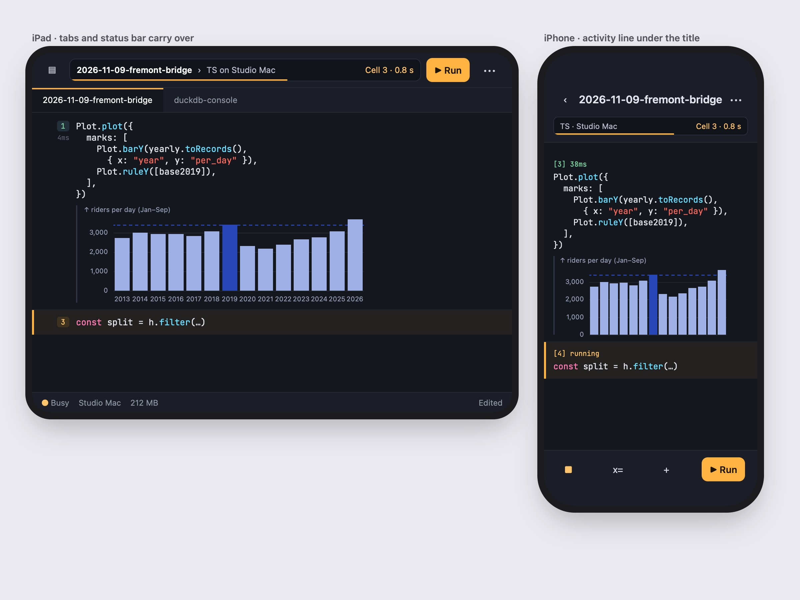

Xcode and Nova lineage: a pro tool, dense on purpose. An activity display
in the toolbar shows file, kernel and progress; tabs join the page with
the active one marked in amber; a status bar takes the subtitle's facts;
cells share one gutter with count and timing; Variables sit in the
inspector.

### C · Document

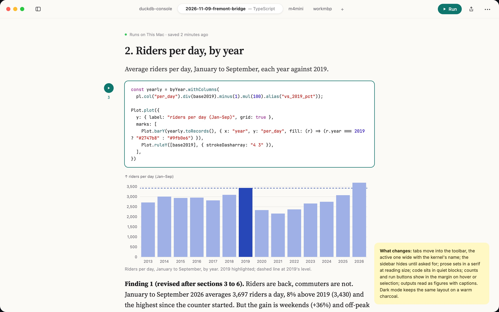

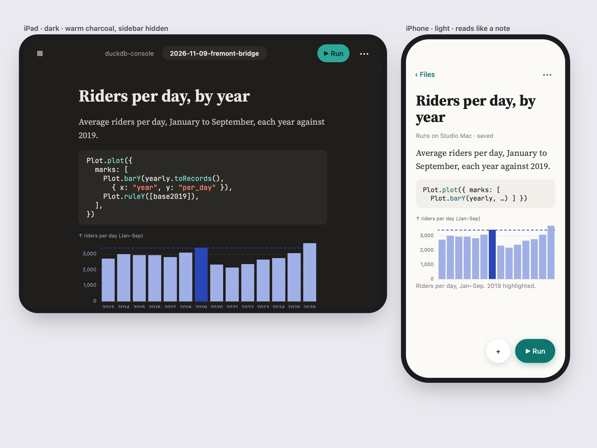

Notes and Pages lineage: writing first. Tabs move into the toolbar, the
sidebar hides until asked for, prose sets in a serif at reading size, and
cell chrome shows only on hover or selection. Liked, but judged too
reserved for real work.

### D · Branded workspace

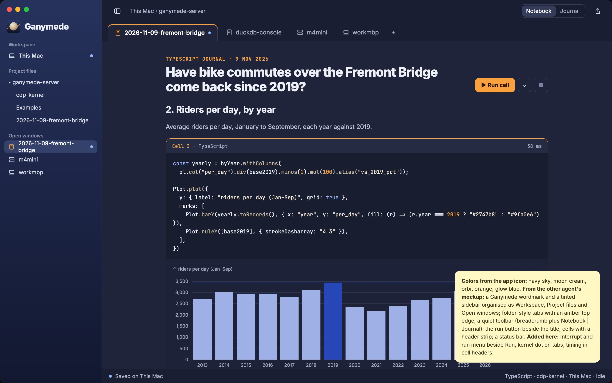

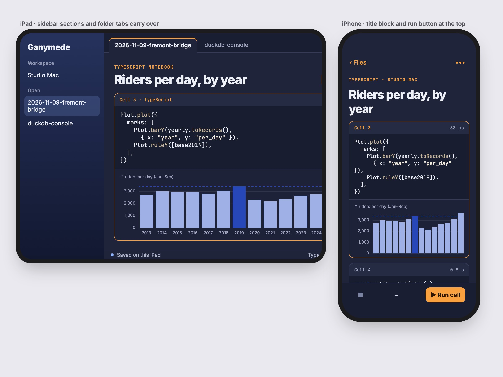

From a mockup another agent had made, recoloured from the app icon: navy
sky, moon cream, orbit orange and glow blue. A Ganymede wordmark, a tinted
sidebar (Workspace, Project files, Open windows), folder-style tabs with an
amber top edge, a quiet toolbar, Run beside the title, cells with a header
strip, and a status bar.

## 3. The choice: A with D

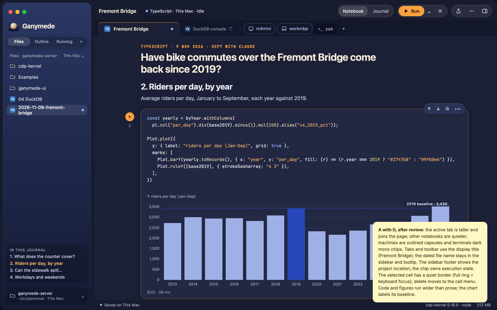

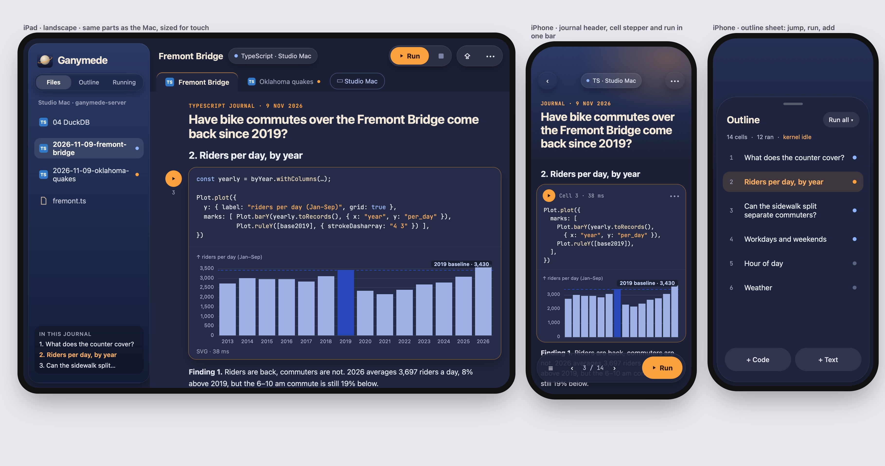

Thomas chose most of A, for its native structure, with D's flavour: the
branding and the app icon's colours. A design review of A then refined
it before the steps were written:

- The active tab is taller, flat-bottomed and joined to the page, with a
  soft top edge (1.5 px, orange at about 55%). Other notebook tabs are
  quieter; machines are outlined capsules and terminals dark mono chips.
- Tabs and the toolbar show a display title ("Fremont Bridge"): the
  notebook's `metadata.title`, else the file name without its date. The
  dated file name stays in the sidebar and the tooltip.
- The selected cell gets a quiet 1 px accent border; the full 2 px ring
  is for keyboard focus only. Delete moves into the cell's ⋯ menu.
- Code and figures run wider than prose (about 1000 px against a 700 px
  measure).
- The sidebar's footer shows the project's folder and location; the
  kernel chip owns execution state.

These became the eight steps in #844.

## 4. Second review: Journal mode, tab states, Split View, iPhone

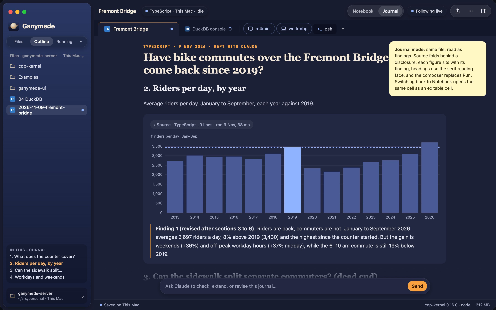

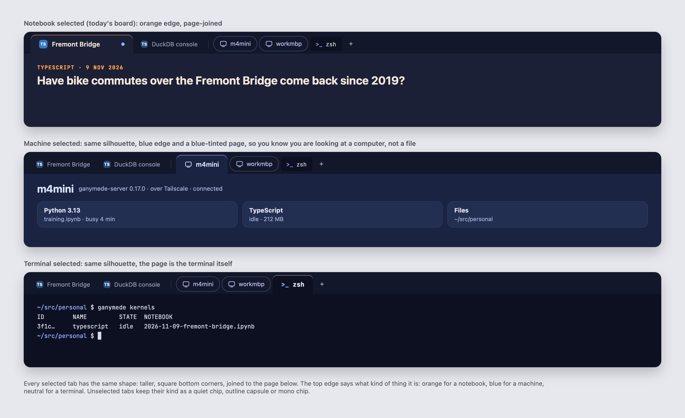

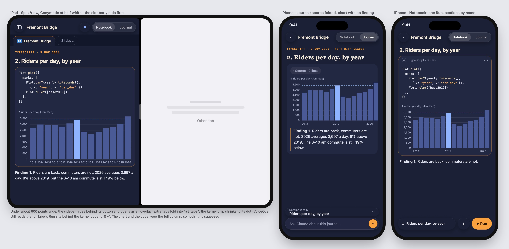

A second round filled in what the first boards left open. Decisions
(Thomas, 26 November, recorded on #844):

- Notebook and Journal keep today's split. Notebook is editable cells and
  Run; Journal is read-only cells with source folded, each figure kept
  with its finding, and the composer at the bottom with room reserved so
  it never covers text.
- Orange marks only Run and the active notebook tab. Busy kernels show a
  blue spinner with an accessible label. The eyebrow shows language and
  date, not the mode.
- A selected tab of any kind has the same page-joined shape. Its top edge
  is orange for a notebook, blue for a machine (with a blue-tinted page)
  and neutral for a terminal.
- On the iPad in Split View, below about 600 pt, the sidebar yields first,
  extra tabs fold into "+N tabs", and the kernel chip shrinks to its dot.
- On the iPhone, Journal folds source by default, section names replace
  "3 / 14" and open the outline sheet, and there is one Run, in the
  bottom bar.

## 5. Step 4: the Mac sidebar

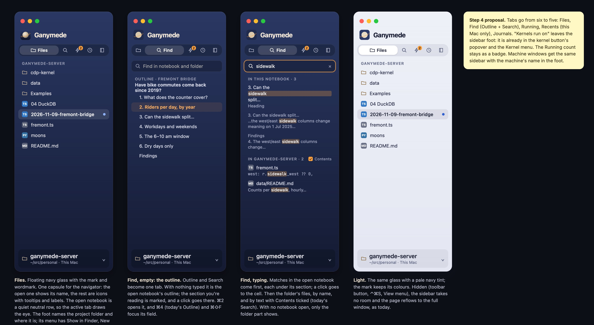

The board for step 4 ([#873](https://github.com/tlockney/ganymede-ui/issues/873),
[#879](https://github.com/tlockney/ganymede-ui/issues/879)). The sidebar
is navy glass with the app mark, its tabs sit in one capsule, and its foot
shows the project. Thomas then folded Outline and Search into one Find
tab: an empty field shows the outline, and a query shows the notebook's
matching cells above the folder's files. That replaced the "In this
journal" outline the chosen board had at the sidebar's foot.

## The boards and the steps of #844

| Step                    | Boards            | State, 27 November 2026                                                                                                   |
| ----------------------- | ----------------- | ------------------------------------------------------------------------------------------------------------------------- |
| 1. Colour tokens        | E-Mac, E-Touch    | Done ([#847](https://github.com/tlockney/ganymede-ui/pull/847))                                                           |
| 2. Cell chrome          | E-Mac, E-Journal  | Done ([#863](https://github.com/tlockney/ganymede-ui/pull/863))                                                           |
| 3. Mac toolbar          | E-Mac, E-Journal  | Done ([#870](https://github.com/tlockney/ganymede-ui/pull/870))                                                           |
| 4. Mac sidebar          | E-Mac, S4-Sidebar | Done ([#876](https://github.com/tlockney/ganymede-ui/pull/876), [#881](https://github.com/tlockney/ganymede-ui/pull/881)) |
| 5. Status bar           | E-Mac             | Open ([#882](https://github.com/tlockney/ganymede-ui/issues/882))                                                         |
| 6. Tabs                 | E-Mac, E-Tabs     | Not started                                                                                                               |
| 7. iPad and iPhone      | E-Touch, E-Touch2 | Not started                                                                                                               |
| 8. Docs and screenshots | all               | Not started                                                                                                               |

## Where it stands after step 4

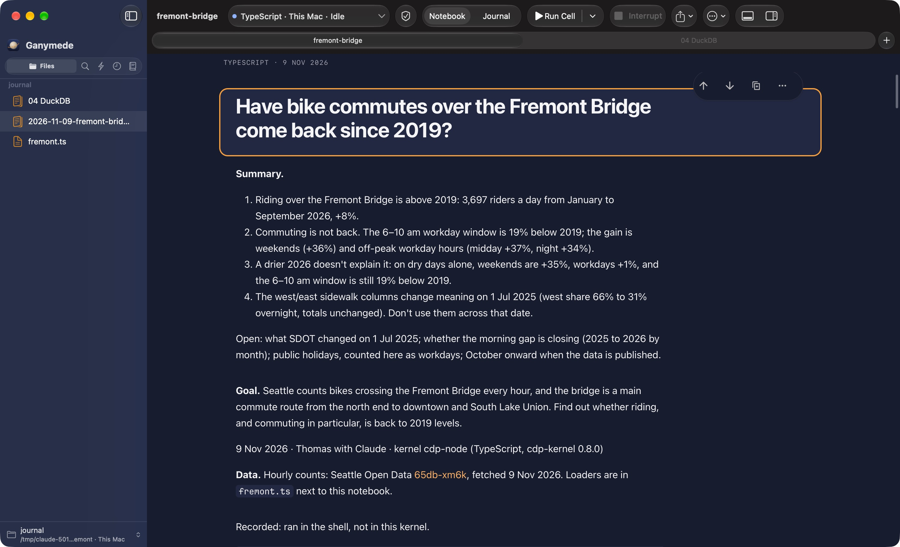

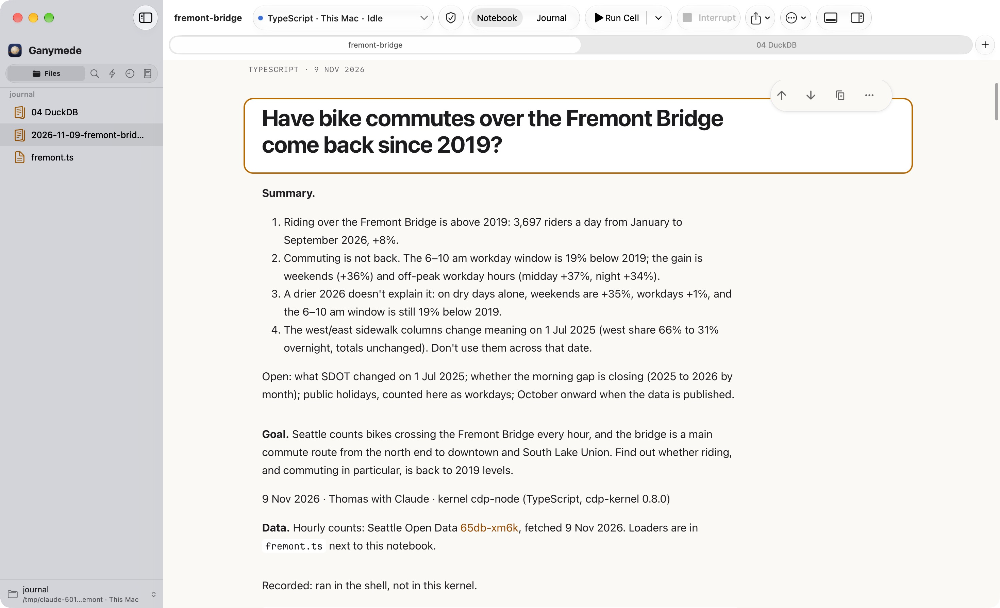

The app at `ab5e893` (step 4b) with the Fremont Bridge journal, beside
the chosen board above. The page and sidebar have the navy and the cell
cards; the band above the page doesn't yet. Gaps found on 27 November:

- **Window chrome:** the title bar is the system's near-black (grey in
  light), not the canvas navy, so the top of the window reads as stock
  macOS.
- **Toolbar** (after step 3): Run is plain "Run Cell", not the orange
  pill; about seven controls pack after the kernel chip where the board
  has three glass groups pushed right (Notebook | Journal; Run ⌄ ■; Share
  ⋯ Inspector); the buttons are opaque system pills, not glass; Interrupt
  is a labelled button, not an icon in the Run group. The title reads
  "fremont-bridge": by the rule above it would need a `metadata.title`
  in the journal, or a different rule, to read "Fremont Bridge".
- **Tabs:** still AppKit's grey, equal-width bar (step 6).
- **Page:** the eyebrow is grey, not orange, and headings are white, not
  moon cream.
- **Sidebar:** full height and flush, not a floating inset panel; plain
  grey in light; notebook rows use a generic icon, not the TS badge.
- **Status bar:** not there yet (step 5).

## Regenerating the images

The boards were rendered from `source/` with WebKit at each board's
canvas size and saved as 2× JPEG. The sizes are in the canvas's index:
1440 × 900 for the Mac boards and Main, 1200 × 900 for the A to D touch
boards, 1820 × 960 for E-Touch, 1440 × 880 for E-Tabs, 1960 × 960 for
E-Touch2 and 1640 × 900 for S4-Sidebar. The sources differ from the
canvas's files in three ways only: no canvas runtime script, links
between boards point at `.html`, and the v0.17.1 screenshot is
`source/v0.17.1.png` rather than a canvas upload.
