# Mac app visual redesign: mockups and how they got here

> [!NOTE]
> Design reference, kept for later (#893). The work is tracked in
> [#844](https://github.com/tlockney/ganymede-ui/issues/844); the table
> at the end says which steps are in the app. Where the app and the
> **Chosen** boards differ, the boards are the target.

These are the boards from the design canvas made on 2026-11-26 and
2026-11-27 (a private claude.ai design canvas, "Mac app visual
directions"). Each board is here as an image in `boards/`. Its source is
in `sources/`, as the canvas wrote it. The sources need the canvas's
runtime to render, so use the images.

## Why: v0.17.1

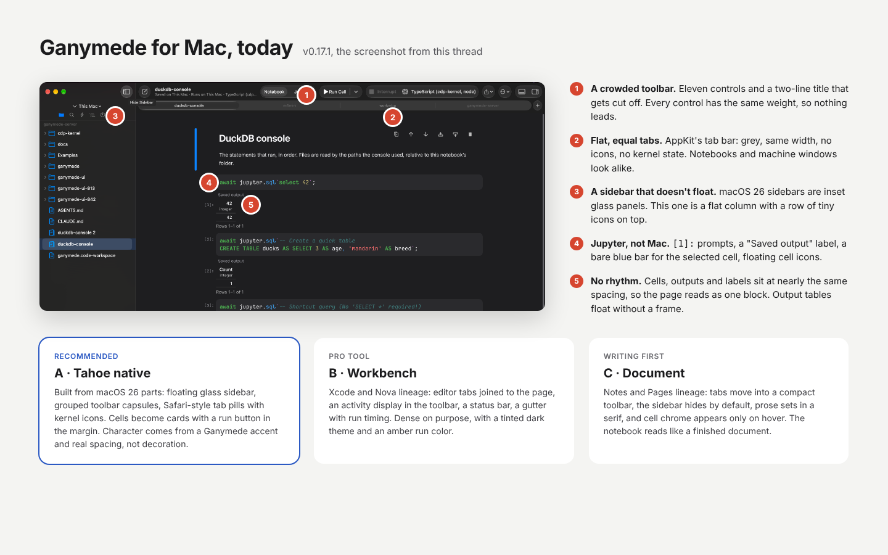

Thomas, on v0.17.1: the notebook UI is "bland and boring", doesn't feel
native, "everything feels compressed or squashed", and the tabs don't
stand out. The first board marks five problems:

1. **A crowded toolbar.** Eleven controls of equal weight, and a two-line
   title that gets cut off. Nothing leads.
2. **Flat, equal tabs.** AppKit's tab bar has no icons and no kernel state,
   and notebooks and machine windows look alike.
3. **A sidebar that doesn't float**, as macOS 26 sidebars do, with a row of
   tiny icons on top.
4. **Jupyter, not Mac:** `[1]:` prompts, a "Saved output" label, a bare blue
   bar on the selected cell, floating cell icons.
5. **No rhythm:** cells, outputs and labels at almost the same spacing.

## Round 1: four directions

Each direction has a Mac board and an iPad and iPhone board.

### A · Tahoe native (recommended)

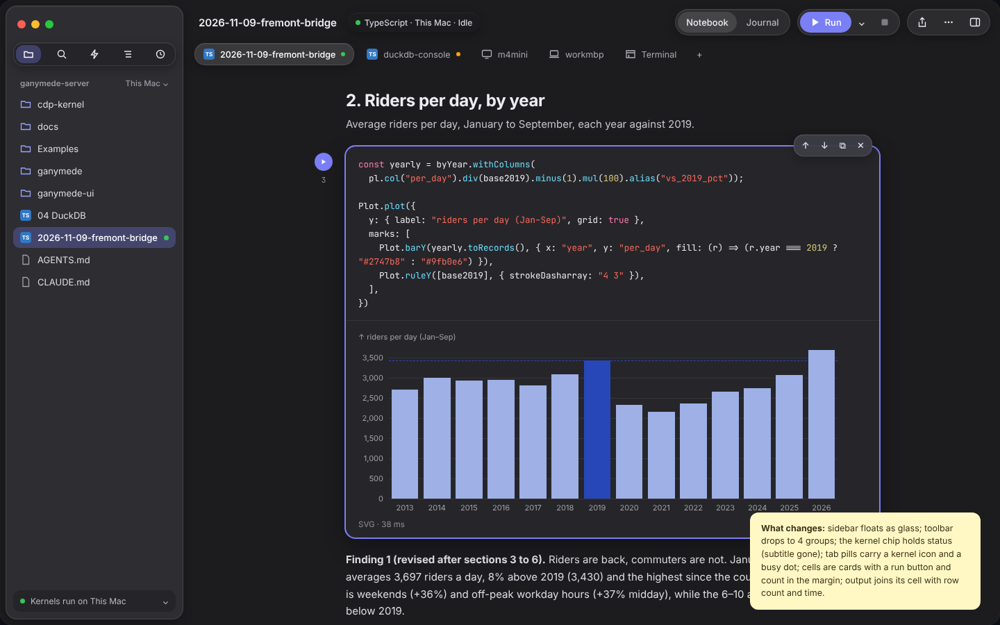
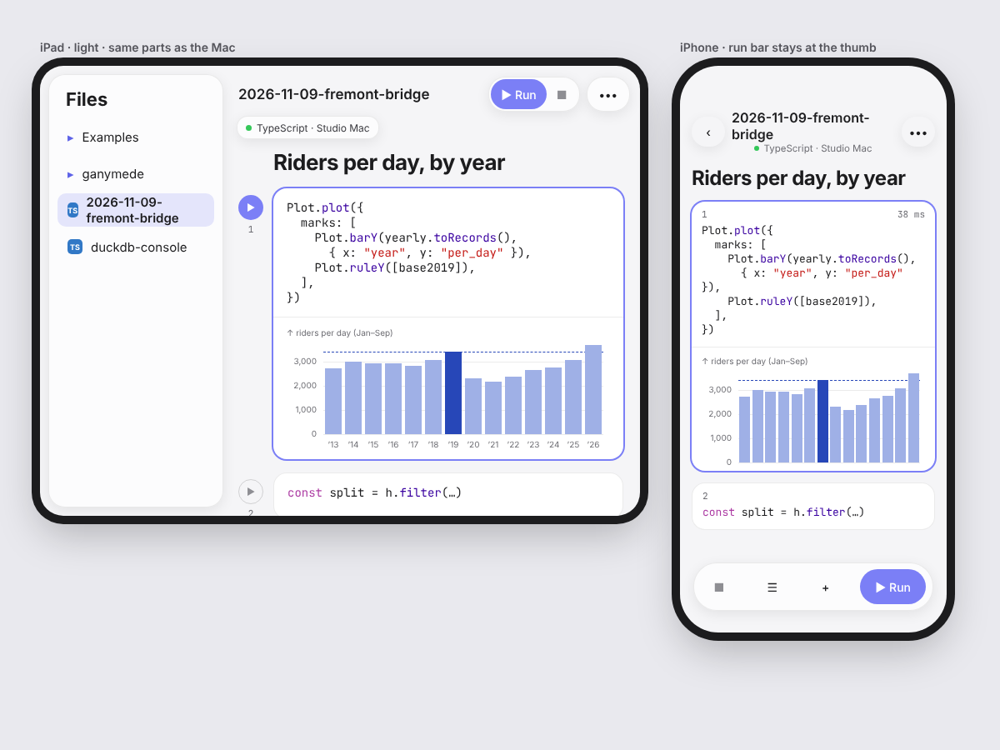

Built from macOS 26 parts: a floating glass sidebar, toolbar controls in
capsule groups, a kernel chip in place of the subtitle, and Safari-style
tab pills with kernel icons. Cells become cards with a run button and count
in the margin, and the output sits in the card with its size and time.
Its own accent was indigo (`#7b7ff6`).

### B · Workbench

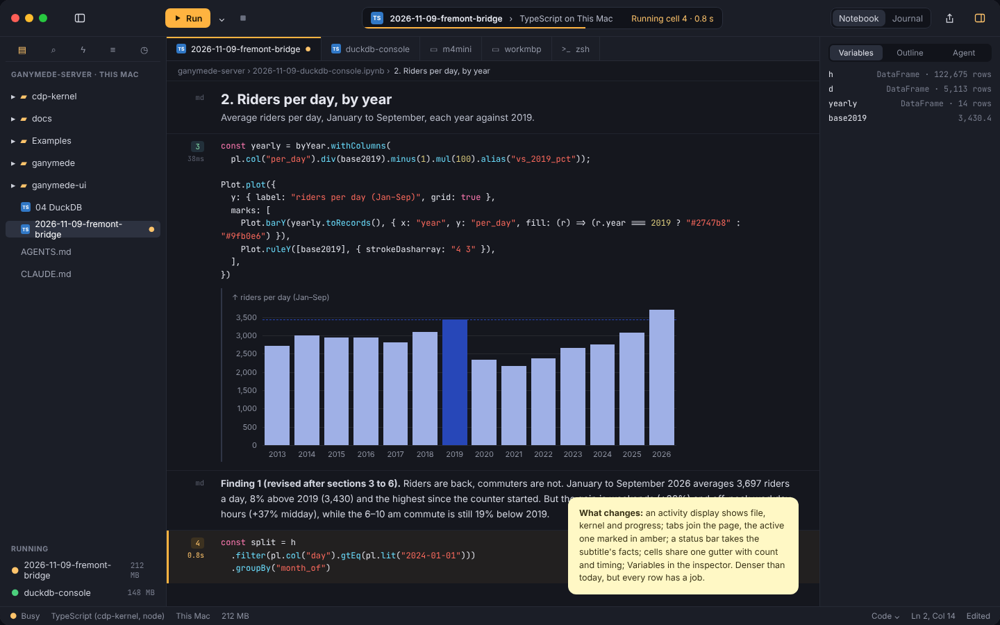
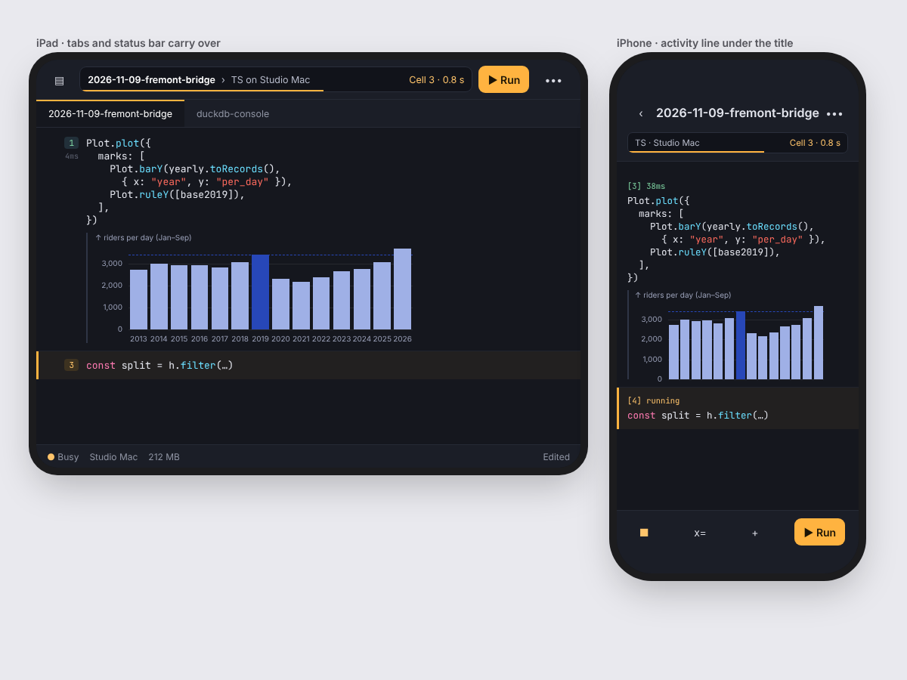

The Xcode and Nova lineage. Editor tabs join the page, and an activity
display in the toolbar shows the file, kernel and progress. A status bar
takes the subtitle's facts, and a gutter shows each cell's count and
timing. Dense on purpose, tinted dark, with amber for Run.

### C · Document

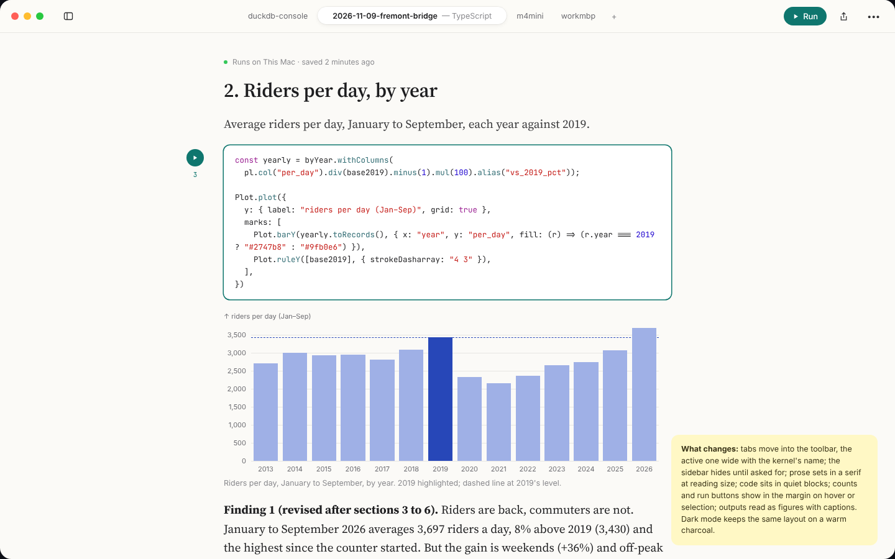
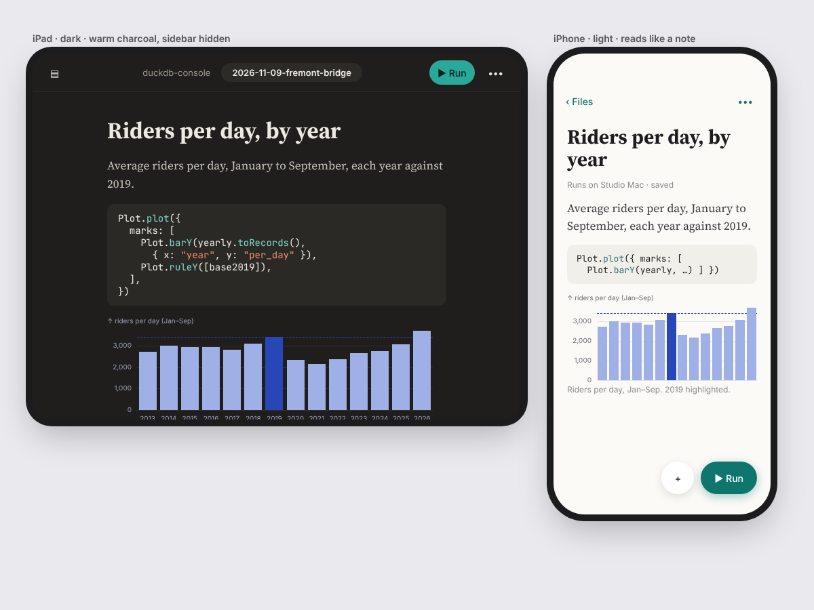

The Notes and Pages lineage. Tabs move into a compact toolbar, the
sidebar is hidden by default, prose sets in a serif, and cell chrome
shows only on hover. Thomas liked it, but found it too reserved for real
work.

### D · Branded workspace

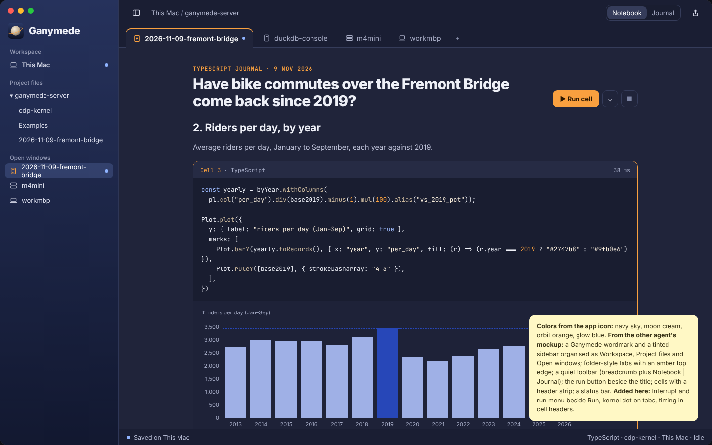
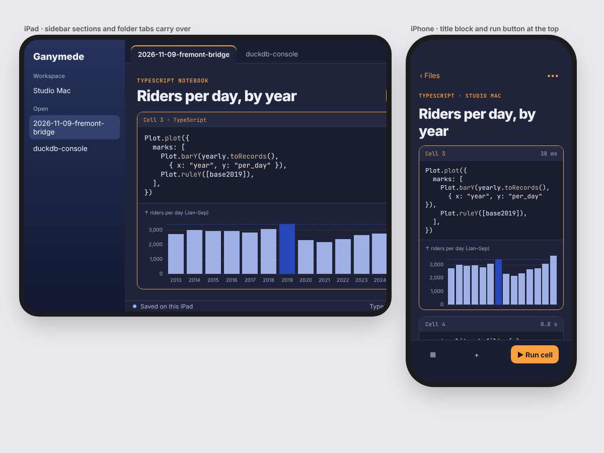

Drawn from a mockup another agent made, which Thomas shared. It has the
Ganymede wordmark, sidebar sections (Workspace, Project files, Open
windows), folder tabs with an orange top edge, Run beside the title, cells
with a header strip, and a status bar. Thomas asked for the app icon's
colors here (`public/icons/icon.svg`):

| Name         | Color                 | Use                                                                                                                          |
| ------------ | --------------------- | ---------------------------------------------------------------------------------------------------------------------------- |
| Navy sky     | `#2b3a67` → `#0d1226` | Dark surfaces, the sidebar tint                                                                                              |
| Moon cream   | `#f4e9d8` / `#c9b79c` | Headings in dark mode, the light ground                                                                                      |
| Orbit orange | `#f9a03f`             | The accent: the one thing to act on (Run, the active tab). Text on it is `#2a1600`; orange text on light uses a darker shade |
| Glow blue    | `#8fb3ff`             | Idle and ready states, keywords                                                                                              |

## Round 2: the Chosen board, A with D's flavor

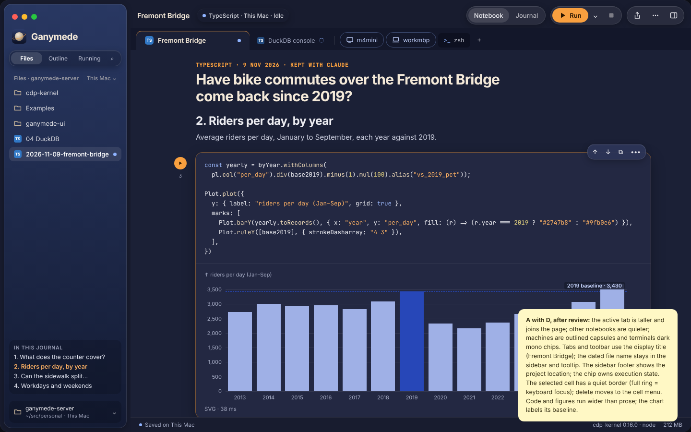
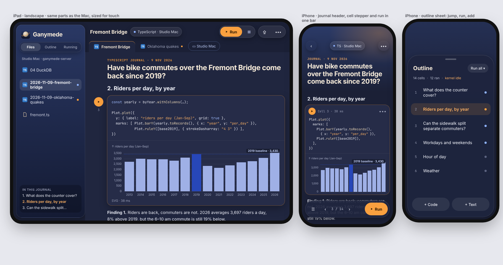

**Thomas chose (2026-11-26 09:07 UTC):** A's layout with D's colors and
branding. An outside review of A was folded in before he chose:

- The active tab is taller and flat-bottomed, and joins the page.
- Other notebook tabs are quieter. Machines are outlined capsules, and
  terminals are dark mono chips.
- Tabs and the toolbar use a short display title ("Fremont Bridge"): the
  notebook's `metadata.title`, else the file name without its date. The
  dated file name stays in the sidebar and the tooltip. (Later, 2026-11-27,
  Thomas added a step: `metadata.title`, else the first `#` heading, else
  the file name without its date; see #892.)
- The kernel chip is the one place that shows execution state.
- The sidebar's footer shows the project's folder and location.
- The selected cell has a quiet border. The full ring is for keyboard
  focus only. Delete moves into the cell's ⋯ menu.
- Code and figures run wider than prose. The chart labels its baseline.

Thomas then softened the active tab's top edge to 1.5px of orange at about
55% ("just what it needed"). He had the iPad and iPhone boards redrawn:
the iPad gets a glass sidebar with an "In this journal" outline. The
iPhone gets a navy-to-orange header, and one bottom bar with the outline
button, a cell stepper ("3 / 14") and Run. He called the redrawn boards
"much better… good enough for now". The sidebar stays collapsible on the
Mac and the iPad, and the page fills the window when it's hidden.

## Round 3: the second review

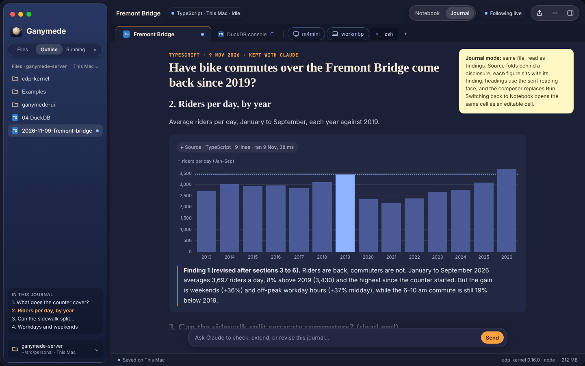
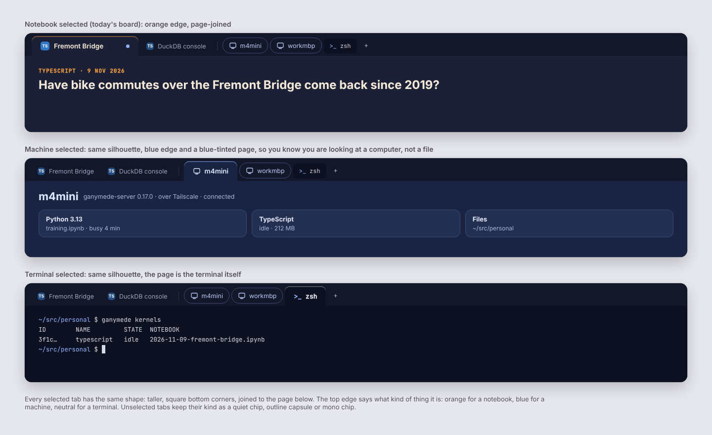
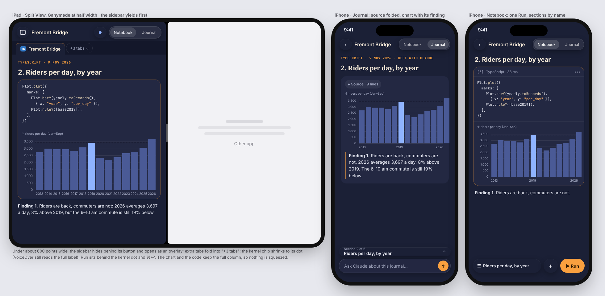

A second outside review added three boards:

- **Journal mode:** the eyebrow no longer says "JOURNAL". The busy marker
  is a blue spinner: orange stays for Run and the active tab only. The
  Mac sidebar gets the iPad's Files / Outline / Running control and the
  "In this journal" outline.
- **Tab states:** every selected tab has the same silhouette, and its top
  edge says what it is. Orange marks a notebook, and blue marks a machine,
  with a blue-tinted page. A neutral edge marks a terminal, whose page is
  the terminal itself.
- **iPad Split View and the iPhone:** in Journal, the iPhone folds the
  source, adds section navigation, and keeps one Run.

**Thomas chose** option A for Notebook versus Journal: Notebook has
editable cells and Run. Journal folds the source and shows the findings,
and stays interactive through the composer and live follow.

## Step 4: the Mac sidebar

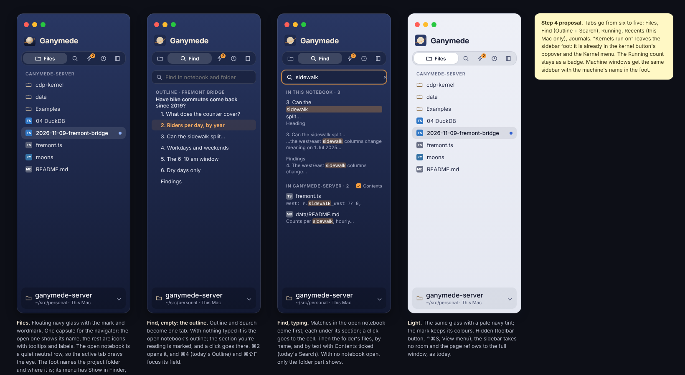

Drawn for step 4, from Thomas's idea of 2026-11-26: merge the sidebar's
Outline and Search into one Find tab. The search field is on top. With an
empty field the tab shows the outline. With a query it shows "In this
notebook" matches under their headings, then "In <folder>" files. Thomas
chose to keep the system's own focused-selection color in the sidebar
list, because SwiftUI ignores a tint there.

## From mockup to app

The steps of #844, and where each stands. Thomas, 2026-11-27: visual
consistency and a clear visual identity are the point of this work, so the
toolbar follow-up and the tabs come before the status bar.

| Step                             | Issue                                                      | State                                                                                               |
| -------------------------------- | ---------------------------------------------------------- | --------------------------------------------------------------------------------------------------- |
| 1. Color tokens                  | [#845](https://github.com/tlockney/ganymede-ui/issues/845) | Merged (#847)                                                                                       |
| 2. Cell chrome                   | [#852](https://github.com/tlockney/ganymede-ui/issues/852) | Merged (#863); falls short of the board: [#897](https://github.com/tlockney/ganymede-ui/issues/897) |
| 3. Mac toolbar                   | [#867](https://github.com/tlockney/ganymede-ui/issues/867) | Merged (#870); falls short of the board: [#892](https://github.com/tlockney/ganymede-ui/issues/892) |
| 4a. Mac sidebar                  | [#873](https://github.com/tlockney/ganymede-ui/issues/873) | Merged (#876); falls short of the board: [#896](https://github.com/tlockney/ganymede-ui/issues/896) |
| 4b. Find tab                     | [#879](https://github.com/tlockney/ganymede-ui/issues/879) | Merged (#881)                                                                                       |
| 3b. Toolbar to match the board   | [#892](https://github.com/tlockney/ganymede-ui/issues/892) | Next                                                                                                |
| 6. Tabs (spike)                  | not filed yet                                              | After [#892](https://github.com/tlockney/ganymede-ui/issues/892)                                    |
| 2b. Page type and selection ring | [#897](https://github.com/tlockney/ganymede-ui/issues/897) | After the tabs                                                                                      |
| 4c. Sidebar float, tint, badges  | [#896](https://github.com/tlockney/ganymede-ui/issues/896) | After the tabs                                                                                      |
| 5. Status bar                    | [#882](https://github.com/tlockney/ganymede-ui/issues/882) | After the tabs                                                                                      |
| 7. iPad and iPhone               | not filed yet                                              | Later                                                                                               |
| 8. Docs and screenshots          | not filed yet                                              | Last                                                                                                |

The acceptance check for #844: on a Mac, in dark and light mode, the
Fremont Bridge journal (`2026-11-09-fremont-bridge.ipynb`) looks like the
Chosen board. Small differences where a native control draws itself are
fine.
